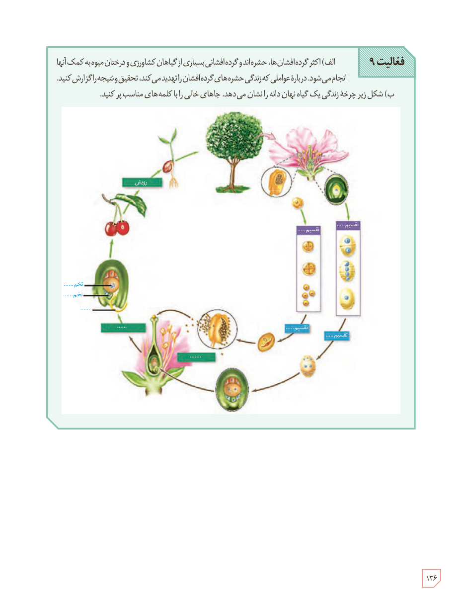

**فعالیت ۹**

الف) اکثر گرده‌افشان‌ها، حشره‌اند و گرده‌افشانی بسیاری از گیاهان کشاورزی و درختان میوه به کمک آنها انجام می‌شود. دربارۀ عواملی که زندگی حشره‌های گرده‌افشان را تهدید می‌کنند، تحقیق و نتیجه را گزارش کنید.

ب) شکل زیر چرخۀ زندگی یک گیاه نهان‌دانه را نشان می‌دهد. جاهای خالی را با کلمه‌های مناسب پر کنید.

برچسب‌های شکل: رویش، تقسیم ......، تقسیم ......، تقسیم ......، تقسیم ......، ......، ......، تخم ......، تخم ......، ...... .

۱۳۶

