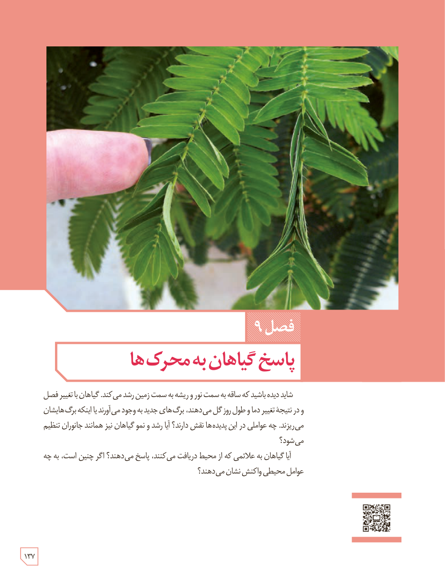

# فصل ۹: پاسخ گیاهان به محرک‌ها

شاید دیده باشید که ساقه به سمت نور و ریشه به سمت زمین رشد می‌کند. گیاهان با تغییر فصل و در نتیجۀ تغییر دما و طول روز گل می‌دهند، برگ‌های جدید به وجود می‌آورند یا اینکه برگ‌هایشان می‌ریزند. چه عواملی در این پدیده‌ها نقش دارند؟ آیا رشد و نمو گیاهان نیز همانند جانوران تنظیم می‌شود؟

آیا گیاهان به علائمی که از محیط دریافت می‌کنند، پاسخ می‌دهند؟ اگر چنین است، به چه عوامل محیطی واکنش نشان می‌دهند؟

۱۳۷

