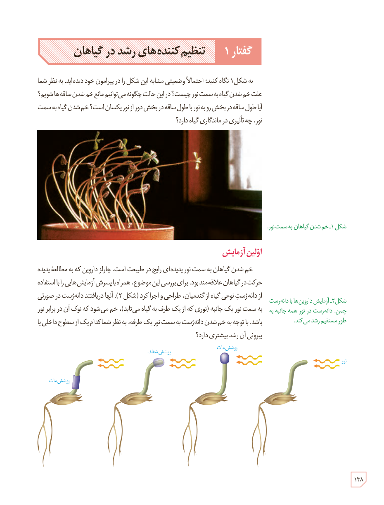

# گفتار ۱: تنظیم‌کننده‌های رشد در گیاهان

به شکل ۱ نگاه کنید. احتمالاً وضعیتی مشابه این شکل را در پیرامون خود دیده‌اید. به نظر شما علت خم شدن گیاه به سمت نور چیست؟ در این حالت چگونه می‌توانیم مانع خم شدن ساقه‌ها شویم؟ آیا طول ساقه در بخش رو به نور با طول ساقه در بخش دور از نور یکسان است؟ خم شدن گیاه به سمت نور، چه تأثیری در ماندگاری گیاه دارد؟

شکل ۱ـ خم شدن گیاهان به سمت نور.

## اولین آزمایش

خم شدن گیاهان به سمت نور پدیده‌ای رایج در طبیعت است. چارلز داروین که به مطالعۀ پدیدۀ حرکت در گیاهان علاقه‌مند بود، برای بررسی این موضوع، همراه با پسرش آزمایش‌هایی را با استفاده از دانه‌رست نوعی گیاه از گندمیان، طراحی و اجرا کرد (شکل ۲). آنها دریافتند دانه‌رست در صورتی به سمت نور یک‌جانبه (نوری که از یک طرف به گیاه می‌تابد)، خم می‌شود که نوک آن در برابر نور باشد. با توجه به خم شدن دانه‌رست به سمت نور یک‌طرفه، به نظر شما کدام یک از سطوح داخلی یا بیرونی آن رشد بیشتری دارد؟

شکل ۲ـ آزمایش داروین‌ها با دانه‌رست چمن. دانه‌رست در نور همه‌جانبه به طور مستقیم رشد می‌کند. برچسب‌ها: نور، پوشش مات، پوشش شفاف.

۱۳۸

