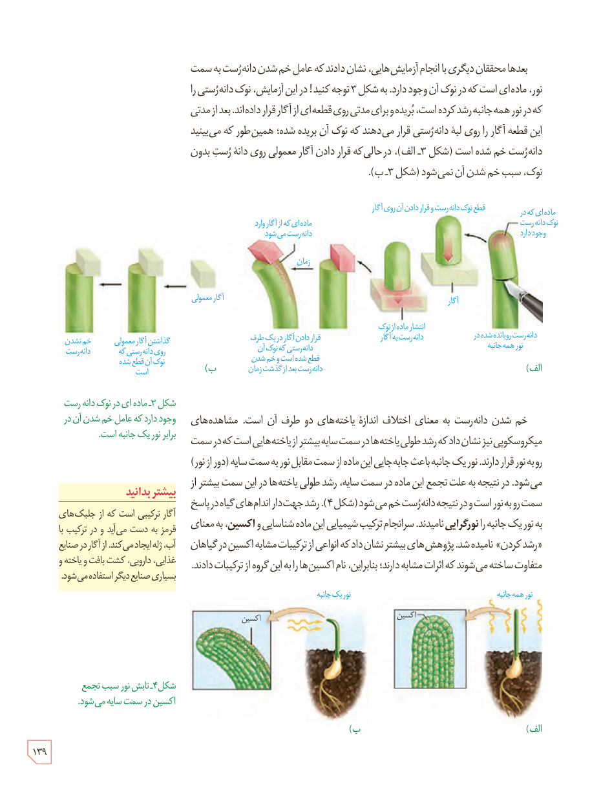

بعدها محققان دیگری با انجام آزمایش‌هایی، نشان دادند که عامل خم شدن دانه‌رست به سمت نور، ماده‌ای است که در نوک آن وجود دارد. به شکل ۳ توجه کنید! در این آزمایش، نوک دانه‌رستی را که در نور همه‌جانبه رشد کرده است، بریدند و برای مدتی روی قطعه‌ای از آگار قرار داده‌اند. بعد از مدتی این قطعه آگار را روی لبۀ دانه‌رستی قرار می‌دهند که نوک آن بریده شده؛ همین‌طور که می‌بینید دانه‌رست خم شده است (شکل ۳ـ الف)، در حالی که قرار دادن آگار معمولی روی دانه‌رست بدون نوک، سبب خم شدن آن نمی‌شود (شکل ۳ـ ب).

شکل ۳ـ ماده‌ای در نوک دانه‌رست وجود دارد که عامل خم شدن آن در برابر نور یک‌جانبه است. برچسب‌ها: ماده‌ای که در نوک دانه‌رست وجود دارد، قطع نوک دانه‌رست و قرار دادن آن روی آگار، آگار، انتشار ماده از نوک دانه‌رست به آگار، دانه‌رست رویانده شده در نور همه‌جانبه، ماده‌ای که از آگار وارد دانه‌رست می‌شود، زمان، قرار دادن آگار در یک طرف دانه‌رستی که نوک آن قطع شده است و خم شدن دانه‌رست بعد از گذشت زمان، آگار معمولی، گذاشتن آگار معمولی روی دانه‌رستی که نوک آن قطع شده است، خم نشدن دانه‌رست.

خم شدن دانه‌رست به معنای اختلاف اندازۀ یاخته‌های دو طرف آن است. مشاهده‌های میکروسکوپی نیز نشان داد که رشد طولی یاخته‌ها در سمت سایه بیشتر از یاخته‌هایی است که در سمت رو به نور قرار دارند. نور یک‌جانبه باعث جابه‌جایی این ماده از سمت مقابل نور به سمت سایه (دور از نور) می‌شود. در نتیجه به علت تجمع این ماده در سمت سایه، رشد طولی یاخته‌ها در این سمت بیشتر از سمت رو به نور است و در نتیجه دانه‌رست خم می‌شود (شکل ۴). رشد جهت‌دار اندام‌های گیاه در پاسخ به نور یک‌جانبه را **نورگرایی** نامیدند. سرانجام ترکیب شیمیایی این ماده شناسایی و **اکسین**، به معنای «رشد کردن» نامیده شد. پژوهش‌های بیشتر نشان داد که انواعی از ترکیبات مشابه اکسین در گیاهان متفاوت ساخته می‌شوند که اثرات مشابه دارند؛ بنابراین، نام اکسین‌ها را به این گروه از ترکیبات دادند.

شکل ۴ـ تابش نور سبب تجمع اکسین در سمت سایه می‌شود. برچسب‌ها: نور همه‌جانبه، نور یک‌جانبه، اکسین.

### بیشتر بدانید

آگار ترکیبی است که از جلبک‌های قرمز به دست می‌آید و در ترکیب با آب، ژله ایجاد می‌کند. از آگار در صنایع غذایی، دارویی، کشت بافت و یاخته و بسیاری صنایع دیگر استفاده می‌شود.

۱۳۹

