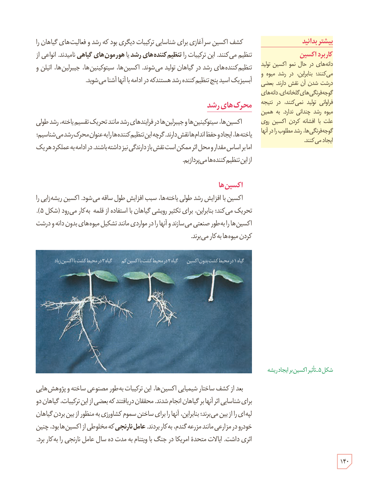

کشف اکسین سرآغازی برای شناسایی ترکیبات دیگری بود که رشد و فعالیت‌های گیاهان را تنظیم می‌کنند. این ترکیبات را **تنظیم‌کننده‌های رشد** یا **هورمون‌های گیاهی** نامیدند. انواعی از تنظیم‌کننده‌های رشد در گیاهان تولید می‌شوند. اکسین‌ها، سیتوکینین‌ها، جیبرلین‌ها، اتیلن و آبسیزیک اسید پنج تنظیم‌کنندۀ رشد هستند که در ادامه با آنها آشنا می‌شوید.

## محرک‌های رشد

اکسین‌ها، سیتوکینین‌ها و جیبرلین‌ها در فرایندهای رشد مانند تحریک تقسیم یاخته، رشد طولی یاخته‌ها، ایجاد و حفظ اندام‌ها نقش دارند. گرچه این تنظیم‌کننده‌ها را به عنوان محرک رشد می‌شناسیم؛ اما بر اساس مقدار و محل اثر ممکن است نقش بازدارندگی نیز داشته باشند. در ادامه به عملکرد هر یک از این تنظیم‌کننده‌ها می‌پردازیم.

### اکسین‌ها

اکسین با افزایش رشد طولی یاخته‌ها، سبب افزایش طول ساقه می‌شود. اکسین ریشه‌زایی را تحریک می‌کند؛ بنابراین، برای تکثیر رویشی گیاهان با استفاده از قلمه به کار می‌رود (شکل ۵). اکسین‌ها را به‌طور صنعتی می‌سازند و آنها را در مواردی مانند تشکیل میوه‌های بدون دانه و درشت کردن میوه‌ها به کار می‌برند.

شکل ۵ـ تأثیر اکسین بر ایجاد ریشه. برچسب‌ها: گیاه ۱ در محیط کشت بدون اکسین، گیاه ۲ در محیط کشت با اکسین کم، گیاه ۳ در محیط کشت با اکسین زیاد.

بعد از کشف ساختار شیمیایی اکسین‌ها، این ترکیبات به‌طور مصنوعی ساخته و پژوهش‌هایی برای شناسایی اثر آنها بر گیاهان انجام شدند. محققان دریافتند که بعضی از این ترکیبات، گیاهان دو لپه‌ای را از بین می‌برند؛ بنابراین، آنها را برای ساختن سموم کشاورزی به منظور از بین بردن گیاهان خودرو در مزارعی مانند مزرعۀ گندم، به کار بردند. **عامل نارنجی** که مخلوطی از اکسین‌ها بود، چنین اثری داشت. ایالات متحدۀ امریکا در جنگ با ویتنام به مدت ده سال عامل نارنجی را به کار برد.

### بیشتر بدانید: کاربرد اکسین

دانه‌های در حال نمو اکسین تولید می‌کنند؛ بنابراین، در رشد میوه و درشت شدن آن نقش دارند. بعضی گوجه‌فرنگی‌های گلخانه‌ای، دانه‌های فراوانی تولید نمی‌کنند، در نتیجه میوه رشد چندانی ندارد. به همین علت با افشانه کردن اکسین روی گوجه‌فرنگی‌ها، رشد مطلوب را در آنها ایجاد می‌کنند.

۱۴۰

