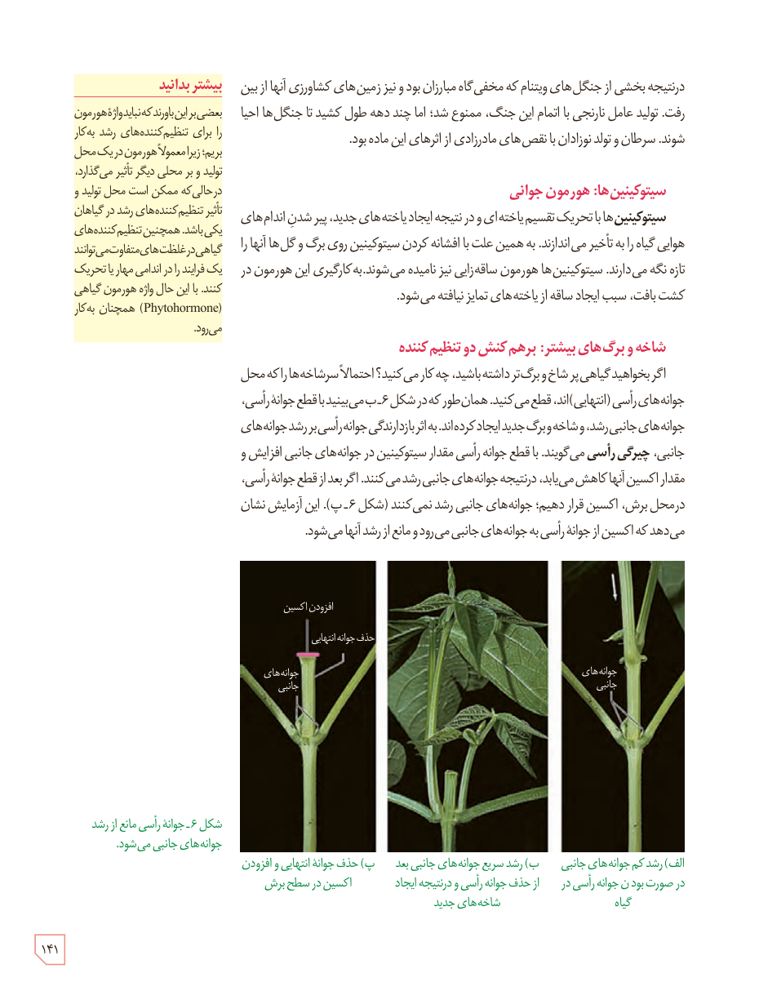

در نتیجه بخشی از جنگل‌های ویتنام که مخفی‌گاه مبارزان بود و نیز زمین‌های کشاورزی آنها از بین رفت. تولید عامل نارنجی با اتمام این جنگ، ممنوع شد؛ اما چند دهه طول کشید تا جنگل‌ها احیا شوند. سرطان و تولد نوزادان با نقص‌های مادرزادی از اثرهای این ماده بود.

### سیتوکینین‌ها: هورمون جوانی

**سیتوکینین‌ها** با تحریک تقسیم یاخته‌ای و در نتیجه ایجاد یاخته‌های جدید، پیر شدن اندام‌های هوایی گیاه را به تأخیر می‌اندازند. به همین علت با افشانه کردن سیتوکینین روی برگ و گل‌ها آنها را تازه نگه می‌دارند. سیتوکینین‌ها هورمون ساقه‌زایی نیز نامیده می‌شوند. به کارگیری این هورمون در کشت بافت، سبب ایجاد ساقه از یاخته‌های تمایز نیافته می‌شود.

### شاخه و برگ‌های بیشتر: برهم‌کنش دو تنظیم‌کننده

اگر بخواهید گیاهی پرشاخ و برگ‌تر داشته باشید، چه کار می‌کنید؟ احتمالاً سرشاخه‌ها را که محل جوانه‌های رأسی (انتهایی)‌اند، قطع می‌کنید. همان‌طور که در شکل ۶ـ ب می‌بینید با قطع جوانۀ رأسی، جوانه‌های جانبی رشد، و شاخه و برگ جدید ایجاد کرده‌اند. به اثر بازدارندگی جوانۀ رأسی بر رشد جوانه‌های جانبی، **چیرگی رأسی** می‌گویند. با قطع جوانۀ رأسی مقدار سیتوکینین در جوانه‌های جانبی افزایش و مقدار اکسین آنها کاهش می‌یابد، در نتیجه جوانه‌های جانبی رشد می‌کنند. اگر بعد از قطع جوانۀ رأسی، در محل برش، اکسین قرار دهیم؛ جوانه‌های جانبی رشد نمی‌کنند (شکل ۶ـ پ). این آزمایش نشان می‌دهد که اکسین از جوانۀ رأسی به جوانه‌های جانبی می‌رود و مانع از رشد آنها می‌شود.

شکل ۶ـ جوانۀ رأسی مانع از رشد جوانه‌های جانبی می‌شود. الف) رشد کم جوانه‌های جانبی در صورت بودن جوانۀ رأسی در گیاه، ب) رشد سریع جوانه‌های جانبی بعد از حذف جوانۀ رأسی و در نتیجه ایجاد شاخه‌های جدید، پ) حذف جوانۀ انتهایی و افزودن اکسین در سطح برش. برچسب‌ها: جوانه‌های جانبی، افزودن اکسین، حذف جوانۀ انتهایی.

### بیشتر بدانید

بعضی بر این باورند که نباید واژۀ هورمون را برای تنظیم‌کننده‌های رشد به کار ببریم؛ زیرا معمولاً هورمون در یک محل تولید و بر محلی دیگر تأثیر می‌گذارد، در حالی که ممکن است محل تولید و تأثیر تنظیم‌کننده‌های رشد در گیاهان یکی باشد. همچنین تنظیم‌کننده‌های گیاهی در غلظت‌های متفاوت می‌توانند یک فرایند را در اندامی مهار یا تحریک کنند. با این حال واژۀ هورمون گیاهی (Phytohormone) همچنان به کار می‌رود.

۱۴۱

