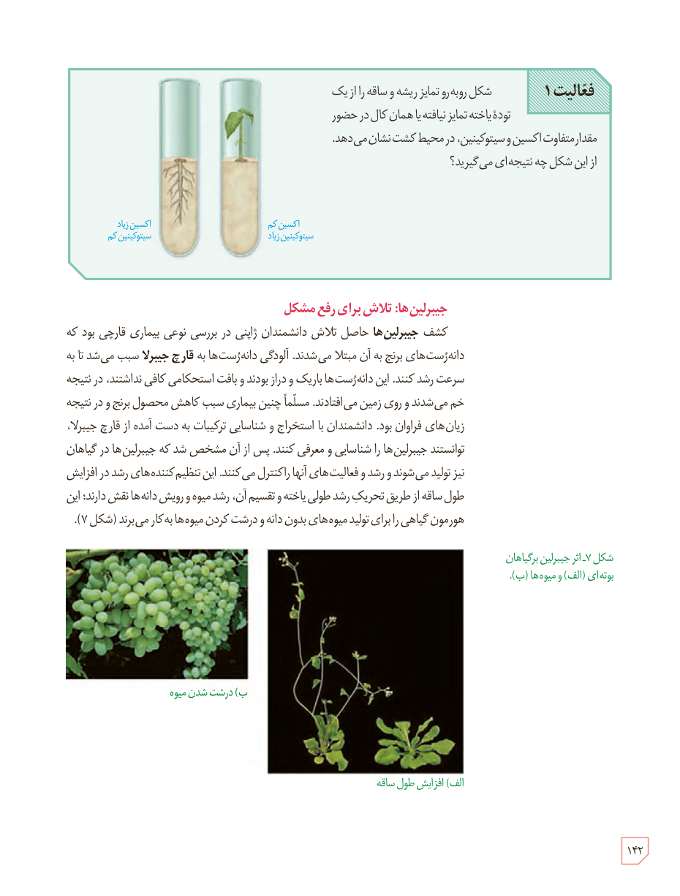

**فعالیت ۱**

شکل روبه‌رو تمایز ریشه و ساقه را از یک تودۀ یاختۀ تمایز نیافته یا همان کال در حضور مقدار متفاوت اکسین و سیتوکینین، در محیط کشت نشان می‌دهد. از این شکل چه نتیجه‌ای می‌گیرید؟

برچسب‌ها: اکسین زیاد، سیتوکینین کم؛ اکسین کم، سیتوکینین زیاد.

### جیبرلین‌ها: تلاش برای رفع مشکل

کشف **جیبرلین‌ها** حاصل تلاش دانشمندان ژاپنی در بررسی نوعی بیماری قارچی بود که دانه‌رست‌های برنج به آن مبتلا می‌شدند. آلودگی دانه‌رست‌ها به **قارچ جیبرلا** سبب می‌شد تا به سرعت رشد کنند. این دانه‌رست‌ها باریک و دراز بودند و بافت استحکامی کافی نداشتند، در نتیجه خم می‌شدند و روی زمین می‌افتادند. مسلماً چنین بیماری سبب کاهش محصول برنج و در نتیجه زیان‌های فراوان بود. دانشمندان با استخراج و شناسایی ترکیبات به دست آمده از قارچ جیبرلا، توانستند جیبرلین‌ها را شناسایی و معرفی کنند. پس از آن مشخص شد که جیبرلین‌ها در گیاهان نیز تولید می‌شوند و رشد و فعالیت‌های آنها را کنترل می‌کنند. این تنظیم‌کننده‌های رشد در افزایش طول ساقه از طریق تحریک رشد طولی یاخته و تقسیم آن، رشد میوه و رویش دانه‌ها نقش دارند؛ این هورمون گیاهی را برای تولید میوه‌های بدون دانه و درشت کردن میوه‌ها به کار می‌برند (شکل ۷).

شکل ۷ـ اثر جیبرلین بر گیاهان بوته‌ای (الف) و میوه‌ها (ب). الف) افزایش طول ساقه، ب) درشت شدن میوه.

۱۴۲

