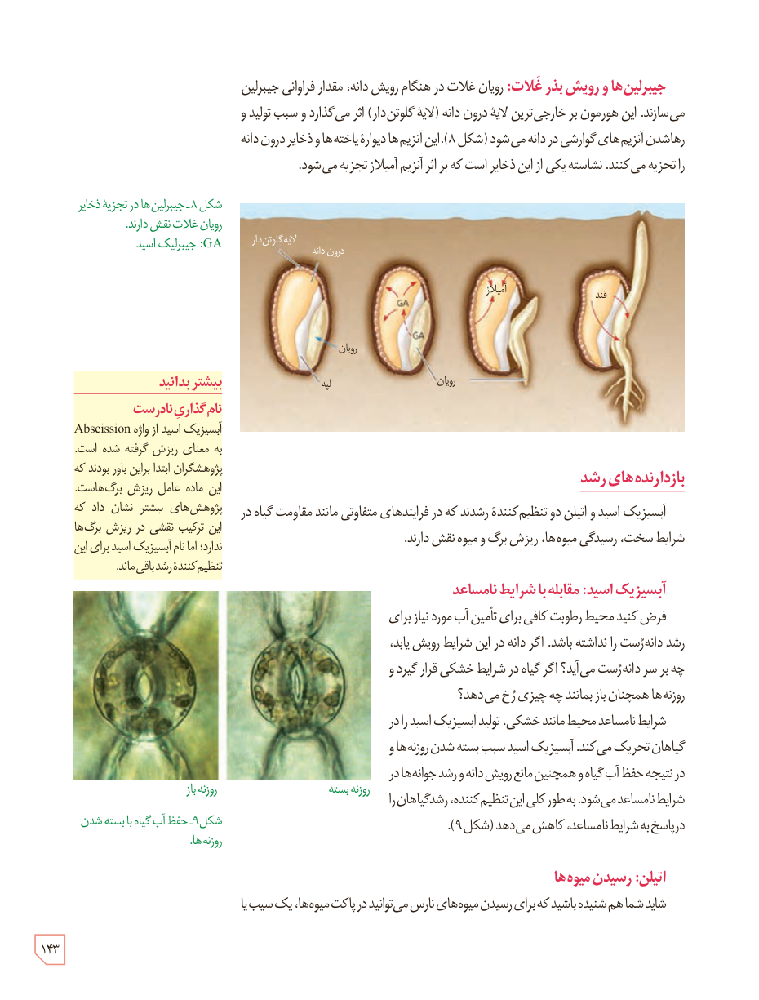

### جیبرلین‌ها و رویش بذر غلات

رویان غلات در هنگام رویش دانه، مقدار فراوانی جیبرلین می‌سازند. این هورمون بر خارجی‌ترین لایۀ درون‌دانه (لایۀ گلوتن‌دار) اثر می‌گذارد و سبب تولید و رهاشدن آنزیم‌های گوارشی در دانه می‌شود (شکل ۸). این آنزیم‌ها دیوارۀ یاخته‌ها و ذخایر درون‌دانه را تجزیه می‌کنند. نشاسته یکی از این ذخایر است که بر اثر آنزیم آمیلاز تجزیه می‌شود.

شکل ۸ـ جیبرلین‌ها در تجزیۀ ذخایر رویان غلات نقش دارند. GA: جیبرلیک اسید. برچسب‌ها: لایۀ گلوتن‌دار، درون‌دانه، رویان، لپه، آمیلاز، قند.

## بازدارنده‌های رشد

آبسیزیک اسید و اتیلن دو تنظیم‌کنندۀ رشدند که در فرایندهای متفاوتی مانند مقاومت گیاه در شرایط سخت، رسیدگی میوه‌ها، ریزش برگ و میوه نقش دارند.

### آبسیزیک اسید: مقابله با شرایط نامساعد

فرض کنید محیط رطوبت کافی برای تأمین آب مورد نیاز برای رشد دانه‌رست را نداشته باشد. اگر دانه در این شرایط رویش یابد، چه بر سر دانه‌رست می‌آید؟ اگر گیاه در شرایط خشکی قرار گیرد و روزنه‌ها همچنان باز بمانند چه چیزی رخ می‌دهد؟

شرایط نامساعد محیط مانند خشکی، تولید آبسیزیک اسید را در گیاهان تحریک می‌کند. آبسیزیک اسید سبب بسته شدن روزنه‌ها و در نتیجه حفظ آب گیاه و همچنین مانع رویش دانه و رشد جوانه‌ها در شرایط نامساعد می‌شود. به طور کلی این تنظیم‌کننده، رشد گیاهان را در پاسخ به شرایط نامساعد، کاهش می‌دهد (شکل ۹).

شکل ۹ـ حفظ آب گیاه با بسته شدن روزنه‌ها. روزنۀ باز، روزنۀ بسته.

### اتیلن: رسیدن میوه‌ها

شاید شما هم شنیده باشید که برای رسیدن میوه‌های نارس می‌توانید در پاکت میوه‌ها، یک سیب یا

### بیشتر بدانید: نام‌گذاری نادرست

آبسیزیک اسید از واژۀ Abscission به معنای ریزش گرفته شده است. پژوهشگران ابتدا براین باور بودند که این ماده عامل ریزش برگ‌هاست. پژوهش‌های بیشتر نشان داد که این ترکیب نقشی در ریزش برگ‌ها ندارد؛ اما نام آبسیزیک اسید برای این تنظیم‌کنندۀ رشد باقی ماند.

۱۴۳

