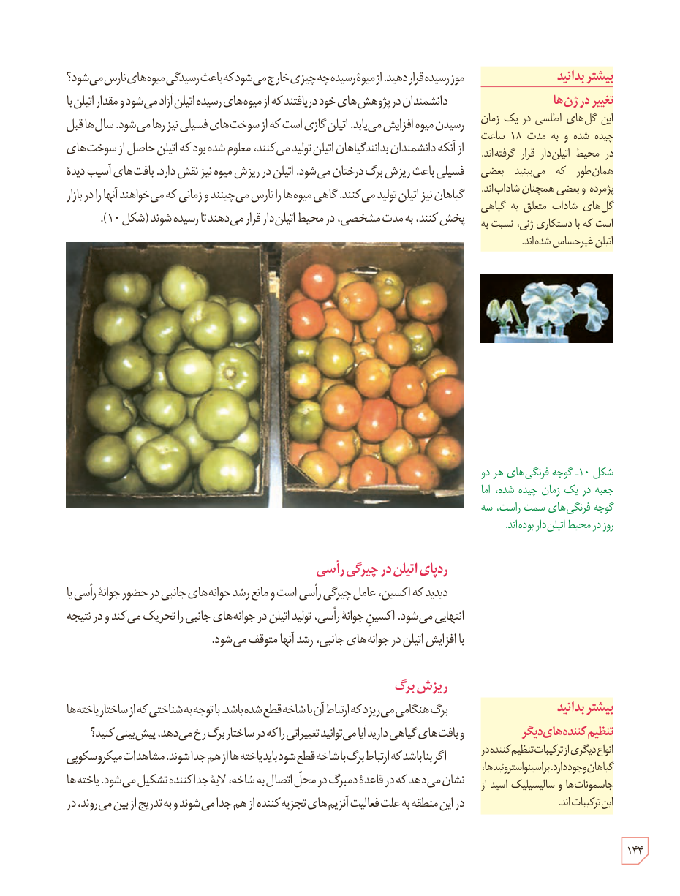

موز رسیده قرار دهید. از میوۀ رسیده چه چیزی خارج می‌شود که باعث رسیدگی میوه‌های نارس می‌شود؟

دانشمندان در پژوهش‌های خود دریافتند که از میوه‌های رسیده اتیلن آزاد می‌شود و مقدار اتیلن با رسیدن میوه افزایش می‌یابد. اتیلن گازی است که از سوخت‌های فسیلی نیز رها می‌شود. سال‌ها قبل از آنکه دانشمندان بدانند گیاهان اتیلن تولید می‌کنند، معلوم شده بود که اتیلن حاصل از سوخت‌های فسیلی باعث ریزش برگ درختان می‌شود. اتیلن در ریزش میوه نیز نقش دارد. بافت‌های آسیب‌دیدۀ گیاهان نیز اتیلن تولید می‌کنند. گاهی میوه‌ها را نارس می‌چینند و زمانی که می‌خواهند آنها را در بازار پخش کنند، به مدت مشخصی، در محیط اتیلن‌دار قرار می‌دهند تا رسیده شوند (شکل ۱۰).

شکل ۱۰ـ گوجه‌فرنگی‌های هر دو جعبه در یک زمان چیده شده، اما گوجه‌فرنگی‌های سمت راست، سه روز در محیط اتیلن‌دار بوده‌اند.

### ردپای اتیلن در چیرگی رأسی

دیدید که اکسین، عامل چیرگی رأسی است و مانع رشد جوانه‌های جانبی در حضور جوانۀ رأسی یا انتهایی می‌شود. اکسین جوانۀ رأسی، تولید اتیلن در جوانه‌های جانبی را تحریک می‌کند و در نتیجه با افزایش اتیلن در جوانه‌های جانبی، رشد آنها متوقف می‌شود.

### ریزش برگ

برگ هنگامی می‌ریزد که ارتباط آن با شاخه قطع شده باشد. با توجه به شناختی که از ساختار یاخته‌ها و بافت‌های گیاهی دارید آیا می‌توانید تغییراتی را که در ساختار برگ رخ می‌دهد، پیش‌بینی کنید؟

اگر بنا باشد که ارتباط برگ با شاخه قطع شود باید یاخته‌ها از هم جدا شوند. مشاهدات میکروسکوپی نشان می‌دهد که در قاعدۀ دمبرگ در محل اتصال به شاخه، لایۀ جداکننده تشکیل می‌شود. یاخته‌ها در این منطقه به علت فعالیت آنزیم‌های تجزیه‌کننده از هم جدا می‌شوند و به تدریج از بین می‌روند، در

### بیشتر بدانید: تغییر در ژن‌ها

این گل‌های اطلسی در یک زمان چیده شده و به مدت ۱۸ ساعت در محیط اتیلن‌دار قرار گرفته‌اند. همان‌طور که می‌بینید بعضی پژمرده و بعضی همچنان شاداب‌اند. گل‌های شاداب متعلق به گیاهی است که با دستکاری ژنی، نسبت به اتیلن غیرحساس شده‌اند.

### بیشتر بدانید: تنظیم‌کننده‌های دیگر

انواع دیگری از ترکیبات تنظیم‌کننده در گیاهان وجود دارند. براسینواستروئیدها، جاسمونات‌ها و سالیسیلیک اسید از این ترکیبات‌اند.

۱۴۴

