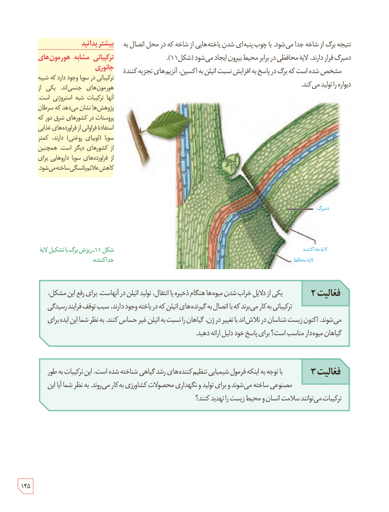

نتیجه برگ از شاخه جدا می‌شود. با چوب‌پنبه‌ای شدن یاخته‌هایی از شاخه که در محل اتصال به دمبرگ قرار دارند، لایۀ محافظی در برابر محیط بیرون ایجاد می‌شود (شکل ۱۱).

مشخص شده است که برگ در پاسخ به افزایش نسبت اتیلن به اکسین، آنزیم‌های تجزیه‌کنندۀ دیواره را تولید می‌کند.

شکل ۱۱ـ ریزش برگ با تشکیل لایۀ جداکننده. برچسب‌ها: دمبرگ، لایۀ جداکننده، لایۀ محافظ.

**فعالیت ۲**

یکی از دلایل خراب شدن میوه‌ها هنگام ذخیره یا انتقال، تولید اتیلن در آنهاست. برای رفع این مشکل، ترکیباتی به کار می‌برند که با اتصال به گیرنده‌های اتیلن که در یاخته وجود دارند، سبب توقف فرایند رسیدگی می‌شوند. اکنون زیست‌شناسان در تلاش‌اند با تغییر در ژن، گیاهان را نسبت به اتیلن غیر حساس کنند. به نظر شما این ایده برای گیاهان میوه‌دار مناسب است؟ برای پاسخ خود دلیل ارائه دهید.

**فعالیت ۳**

با توجه به اینکه فرمول شیمیایی تنظیم‌کننده‌های رشد گیاهی شناخته شده است، این ترکیبات به طور مصنوعی ساخته می‌شوند و برای تولید و نگهداری محصولات کشاورزی به کار می‌روند. به نظر شما آیا این ترکیبات می‌توانند سلامت انسان و محیط زیست را تهدید کنند؟

### بیشتر بدانید: ترکیباتی مشابه هورمون‌های جانوری

ترکیباتی در سویا وجود دارد که شبیه هورمون‌های جنسی‌اند. یکی از آنها ترکیبات شبه استروژنی است. پژوهش‌ها نشان می‌دهد که سرطان پروستات در کشورهای شرق دور که استفادۀ فراوانی از فرآورده‌های غذایی سویا (لوبیای روغنی) دارند، کمتر از کشورهای دیگر است. همچنین از فرآورده‌های سویا داروهایی برای کاهش علائم یائسگی ساخته می‌شود.

۱۴۵

