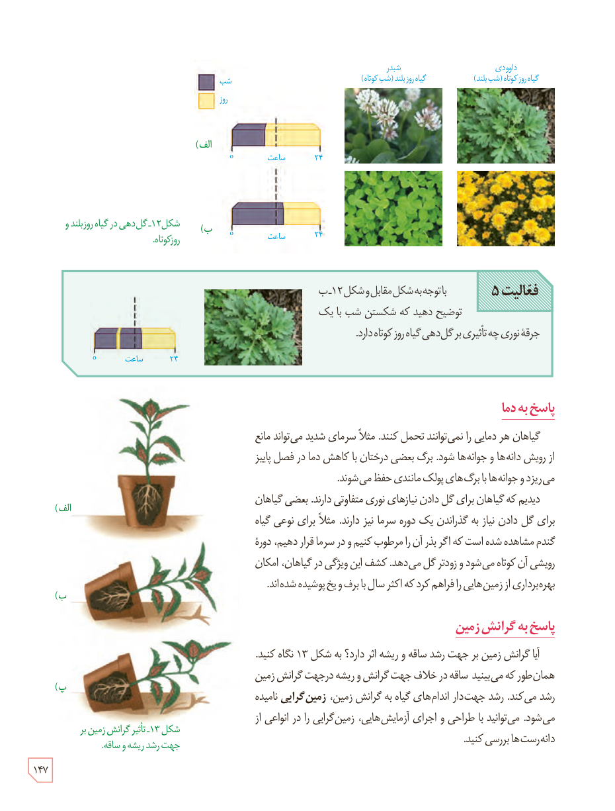

شکل ۱۲ـ گل‌دهی در گیاه روز بلند و روز کوتاه. برچسب‌ها: شب، روز، ساعت، شبدر گیاه روز بلند (شب کوتاه)، داوودی گیاه روز کوتاه (شب بلند).

**فعالیت ۵**

با توجه به شکل مقابل و شکل ۱۲ـ ب توضیح دهید که شکستن شب با یک جرقۀ نوری چه تأثیری بر گل‌دهی گیاه روز کوتاه دارد.

## پاسخ به دما

گیاهان هر دمایی را نمی‌توانند تحمل کنند. مثلاً سرمای شدید می‌تواند مانع از رویش دانه‌ها و جوانه‌ها شود. برگ بعضی درختان با کاهش دما در فصل پاییز می‌ریزد و جوانه‌ها با برگ‌های پولک‌مانندی حفظ می‌شوند.

دیدیم که گیاهان برای گل دادن نیازهای نوری متفاوتی دارند. بعضی گیاهان برای گل دادن نیاز به گذراندن یک دوره سرما نیز دارند. مثلاً برای نوعی گیاه گندم مشاهده شده است که اگر بذر آن را مرطوب کنیم و در سرما قرار دهیم، دورۀ رویشی آن کوتاه می‌شود و زودتر گل می‌دهد. کشف این ویژگی در گیاهان، امکان بهره‌برداری از زمین‌هایی را فراهم کرد که اکثر سال با برف و یخ پوشیده شده‌اند.

## پاسخ به گرانش زمین

آیا گرانش زمین بر جهت رشد ساقه و ریشه اثر دارد؟ به شکل ۱۳ نگاه کنید. همان‌طور که می‌بینید ساقه در خلاف جهت گرانش و ریشه در جهت گرانش زمین رشد می‌کند. رشد جهت‌دار اندام‌های گیاه به گرانش زمین، **زمین‌گرایی** نامیده می‌شود. می‌توانید با طراحی و اجرای آزمایش‌هایی، زمین‌گرایی را در انواعی از دانه‌رست‌ها بررسی کنید.

شکل ۱۳ـ تأثیر گرانش زمین بر جهت رشد ریشه و ساقه.

۱۴۷

