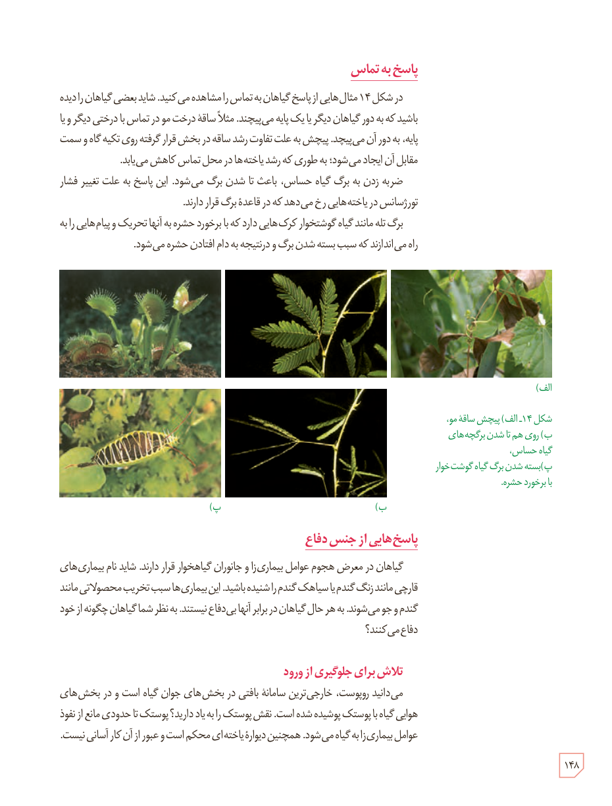

## پاسخ به تماس

در شکل ۱۴ مثال‌هایی از پاسخ گیاهان به تماس را مشاهده می‌کنید. شاید بعضی گیاهان را دیده باشید که به دور گیاهان دیگر یا یک پایه می‌پیچند. مثلاً ساقۀ درخت مو در تماس با درختی دیگر و یا پایه، به دور آن می‌پیچد. پیچش به علت تفاوت رشد ساقه در بخش قرار گرفته روی تکیه‌گاه و سمت مقابل آن ایجاد می‌شود؛ به طوری که رشد یاخته‌ها در محل تماس کاهش می‌یابد.

ضربه زدن به برگ گیاه حساس، باعث تا شدن برگ می‌شود. این پاسخ به علت تغییر فشار تورژسانس در یاخته‌هایی رخ می‌دهد که در قاعدۀ برگ قرار دارند.

برگ تله مانند گیاه گوشت‌خوار کرک‌هایی دارد که با برخورد حشره به آنها تحریک و پیام‌هایی را به راه می‌اندازند که سبب بسته شدن برگ و در نتیجه به دام افتادن حشره می‌شود.

شکل ۱۴ـ الف) پیچش ساقۀ مو، ب) روی هم تا شدن برگچه‌های گیاه حساس، پ) بسته شدن برگ گیاه گوشت‌خوار با برخورد حشره.

## پاسخ‌هایی از جنس دفاع

گیاهان در معرض هجوم عوامل بیماری‌زا و جانوران گیاه‌خوار قرار دارند. شاید نام بیماری‌های قارچی مانند زنگ گندم یا سیاهک گندم را شنیده باشید. این بیماری‌ها سبب تخریب محصولاتی مانند گندم و جو می‌شوند. به هر حال، گیاهان در برابر آنها بی‌دفاع نیستند. به نظر شما گیاهان چگونه از خود دفاع می‌کنند؟

### تلاش برای جلوگیری از ورود

می‌دانید روپوست، خارجی‌ترین سامانۀ بافتی در بخش‌های جوان گیاه است و در بخش‌های هوایی گیاه با پوستک پوشیده شده است. نقش پوستک را به یاد دارید؟ پوستک تا حدودی مانع از نفوذ عوامل بیماری‌زا به گیاه می‌شود. همچنین دیوارۀ یاخته‌ای محکم است و عبور از آن کار آسانی نیست.

۱۴۸

