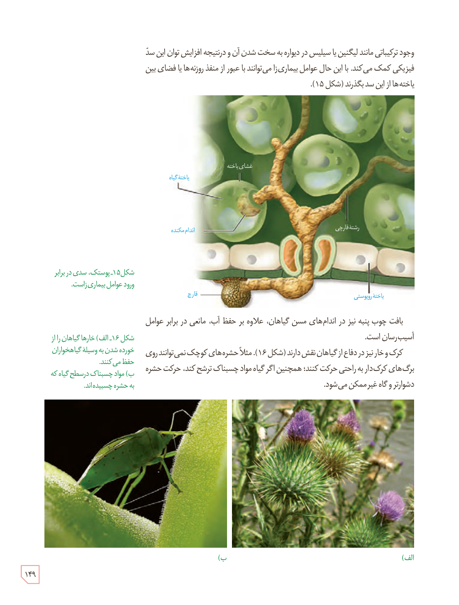

وجود ترکیباتی مانند لیگنین یا سیلیس در دیواره به سخت شدن آن و در نتیجه افزایش توان این سد فیزیکی کمک می‌کند. با این حال عوامل بیماری‌زا می‌توانند با عبور از منفذ روزنه‌ها یا فضای بین یاخته‌ها از این سد بگذرند (شکل ۱۵).

شکل ۱۵ـ پوستک، سدی در برابر ورود عوامل بیماری‌زاست. برچسب‌ها: غشای یاخته، یاختۀ گیاه، اندام مکنده، رشتۀ قارچی، قارچ، یاختۀ روپوستی.

بافت چوب‌پنبه نیز در اندام‌های مسن گیاهان، علاوه بر حفظ آب، مانعی در برابر عوامل آسیب‌رسان است.

کرک و خار نیز در دفاع از گیاهان نقش دارند (شکل ۱۶). مثلاً حشره‌های کوچک نمی‌توانند روی برگ‌های کرک‌دار به راحتی حرکت کنند؛ همچنین اگر گیاه مواد چسبناک ترشح کند، حرکت حشره دشوارتر و گاه غیرممکن می‌شود.

شکل ۱۶ـ الف) خارها گیاهان را از خورده شدن به‌وسیلۀ گیاه‌خواران حفظ می‌کنند. ب) مواد چسبناک در سطح گیاه که به حشره چسبیده‌اند.

۱۴۹

