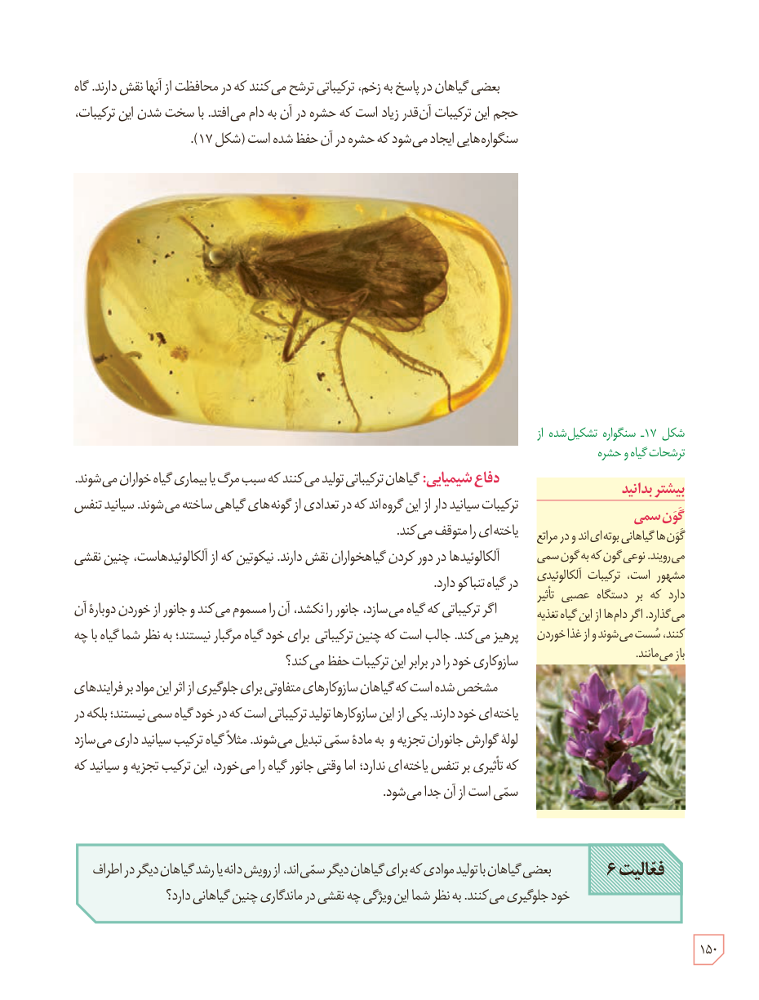

بعضی گیاهان در پاسخ به زخم، ترکیباتی ترشح می‌کنند که در محافظت از آنها نقش دارند. گاه حجم این ترکیبات آن‌قدر زیاد است که حشره در آن به دام می‌افتد. با سخت شدن این ترکیبات، سنگواره‌هایی ایجاد می‌شود که حشره در آن حفظ شده است (شکل ۱۷).

شکل ۱۷ـ سنگوارۀ تشکیل شده از ترشحات گیاه و حشره

**دفاع شیمیایی:** گیاهان ترکیباتی تولید می‌کنند که سبب مرگ یا بیماری گیاه‌خواران می‌شوند. ترکیبات سیانیددار از این گروه‌اند که در تعدادی از گونه‌های گیاهی ساخته می‌شوند. سیانید تنفس یاخته‌ای را متوقف می‌کند.

آلکالوئیدها در دور کردن گیاه‌خواران نقش دارند. نیکوتین که از آلکالوئیدهاست، چنین نقشی در گیاه تنباکو دارد.

اگر ترکیباتی که گیاه می‌سازد، جانور را نکشد، آن را مسموم می‌کند و جانور از خوردن دوبارۀ آن پرهیز می‌کند. جالب است که چنین ترکیباتی برای خود گیاه مرگبار نیستند؛ به نظر شما گیاه با چه سازوکاری خود را در برابر این ترکیبات حفظ می‌کند؟

مشخص شده است که گیاهان سازوکارهای متفاوتی برای جلوگیری از اثر این مواد بر فرایندهای یاخته‌ای خود دارند. یکی از این سازوکارها تولید ترکیباتی است که در خود گیاه سمی نیستند؛ بلکه در لولۀ گوارش جانوران تجزیه و به مادۀ سمی تبدیل می‌شوند. مثلاً گیاه ترکیب سیانیدداری می‌سازد که تأثیری بر تنفس یاخته‌ای ندارد؛ اما وقتی جانور گیاه را می‌خورد، این ترکیب تجزیه و سیانید که سمی است از آن جدا می‌شود.

**فعالیت ۶**

بعضی گیاهان با تولید موادی که برای گیاهان دیگر سمی‌اند، از رویش دانه یا رشد گیاهان دیگر در اطراف خود جلوگیری می‌کنند. به نظر شما این ویژگی چه نقشی در ماندگاری چنین گیاهانی دارد؟

### بیشتر بدانید: گون سمی

گون‌ها گیاهانی بوته‌ای‌اند و در مراتع می‌رویند. نوعی گون که به گون سمی مشهور است، ترکیبات آلکالوئیدی دارد که بر دستگاه عصبی تأثیر می‌گذارد. اگر دام‌ها از این گیاه تغذیه کنند، سست می‌شوند و از غذا خوردن باز می‌مانند.

۱۵۰

