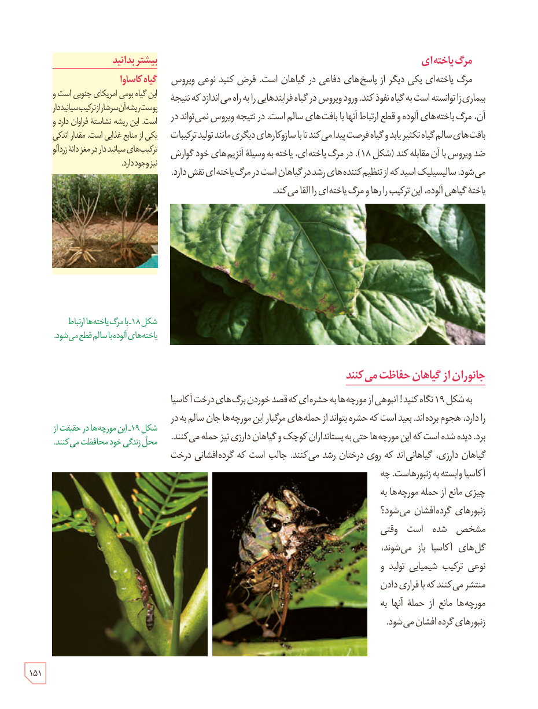

## مرگ یاخته‌ای

مرگ یاخته‌ای یکی دیگر از پاسخ‌های دفاعی در گیاهان است. فرض کنید نوعی ویروس بیماری‌زا توانسته است به گیاه نفوذ کند. ورود ویروس در گیاه فرایندهایی را به راه می‌اندازد که نتیجۀ آن، مرگ یاخته‌های آلوده و قطع ارتباط آنها با بافت‌های سالم است. در نتیجه ویروس نمی‌تواند در بافت‌های سالم گیاه تکثیر یابد و گیاه فرصت پیدا می‌کند تا با سازوکارهای دیگری مانند تولید ترکیبات ضد ویروس با آن مقابله کند (شکل ۱۸). در مرگ یاخته‌ای، یاخته به وسیلۀ آنزیم‌های خود گوارش می‌شود. سالیسیلیک اسید که از تنظیم‌کننده‌های رشد در گیاهان است در مرگ یاخته‌ای نقش دارد. یاختۀ گیاهی آلوده، این ترکیب را رها و مرگ یاخته‌ای را القا می‌کند.

شکل ۱۸ـ با مرگ یاخته‌ها ارتباط یاخته‌های آلوده با سالم قطع می‌شود.

## جانوران از گیاهان حفاظت می‌کنند

به شکل ۱۹ نگاه کنید! انبوهی از مورچه‌ها به حشره‌ای که قصد خوردن برگ‌های درخت آکاسیا را دارد، هجوم برده‌اند. بعید است که حشره بتواند از حمله‌های مرگبار این مورچه‌ها جان سالم به در برد. دیده شده است که این مورچه‌ها حتی به پستانداران کوچک و گیاهان دارزی نیز حمله می‌کنند. گیاهان دارزی، گیاهانی‌اند که روی درختان رشد می‌کنند. جالب است که گرده‌افشانی درخت آکاسیا وابسته به زنبورهاست. چه چیزی مانع از حملۀ مورچه‌ها به زنبورهای گرده‌افشان می‌شود؟ مشخص شده است وقتی گل‌های آکاسیا باز می‌شوند، نوعی ترکیب شیمیایی تولید و منتشر می‌کنند که با فراری دادن مورچه‌ها مانع از حملۀ آنها به زنبورهای گرده‌افشان می‌شود.

شکل ۱۹ـ این مورچه‌ها در حقیقت از محل زندگی خود محافظت می‌کنند.

### بیشتر بدانید: گیاه کاساوا

این گیاه بومی امریکای جنوبی است و پوست ریشۀ آن سرشار از ترکیب سیانیددار است. این ریشه نشاستۀ فراوان دارد و یکی از منابع غذایی است. مقدار اندکی ترکیب‌های سیانیددار در مغز دانۀ زردآلو نیز وجود دارد.

۱۵۱

