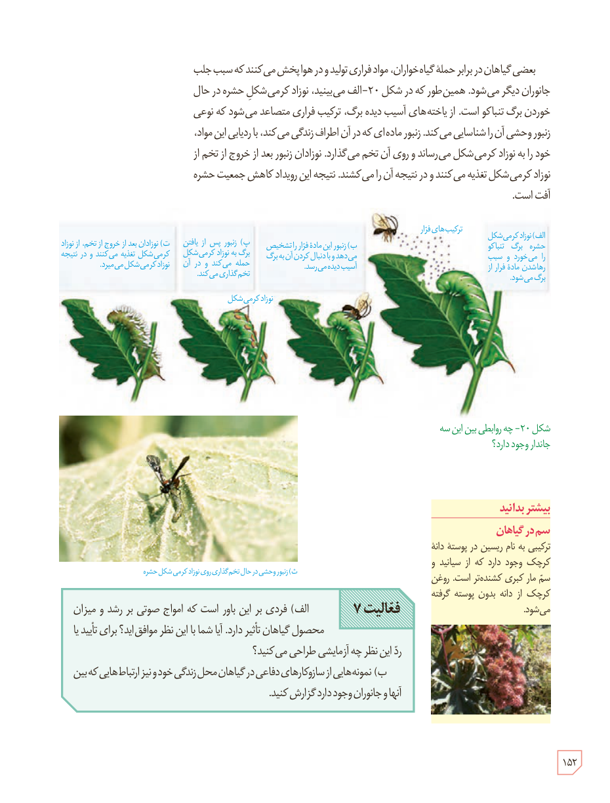

بعضی گیاهان در برابر حملۀ گیاه‌خواران، مواد فراری تولید و در هوا پخش می‌کنند که سبب جلب جانوران دیگر می‌شود. همین‌طور که در شکل ۲۰ـ الف می‌بینید، نوزاد کرمی‌شکل حشره در حال خوردن برگ تنباکو است. از یاخته‌های آسیب‌دیدۀ برگ، ترکیب فراری متصاعد می‌شود که نوعی زنبور وحشی آن را شناسایی می‌کند. زنبور ماده‌ای که در آن اطراف زندگی می‌کند، با ردیابی این مواد، خود را به نوزاد کرمی‌شکل می‌رساند و روی آن تخم می‌گذارد. نوزادان زنبور بعد از خروج از تخم از نوزاد کرمی‌شکل تغذیه می‌کنند و در نتیجه آن را می‌کشند. نتیجۀ این رویداد کاهش جمعیت حشرۀ آفت است.

شکل ۲۰ـ چه روابطی بین این سه جاندار وجود دارد؟ الف) نوزاد کرمی‌شکل حشره برگ تنباکو را می‌خورد و سبب رها شدن مادۀ فرار از برگ می‌شود. ب) زنبور این مادۀ فرار را تشخیص می‌دهد و با دنبال کردن آن به برگ آسیب‌دیده می‌رسد. پ) زنبور پس از یافتن برگ به نوزاد کرمی‌شکل حمله می‌کند و در آن تخم‌گذاری می‌کند. ت) نوزادان بعد از خروج از تخم، از نوزاد کرمی‌شکل تغذیه می‌کنند و در نتیجه نوزاد کرمی‌شکل می‌میرد. ث) زنبور وحشی در حال تخم‌گذاری روی نوزاد کرمی‌شکل حشره.

**فعالیت ۷**

الف) فردی بر این باور است که امواج صوتی بر رشد و میزان محصول گیاهان تأثیر دارد. آیا شما با این نظر موافق‌اید؟ برای تأیید یا رد این نظر چه آزمایشی طراحی می‌کنید؟

ب) نمونه‌هایی از سازوکارهای دفاعی در گیاهان محل زندگی خود و نیز ارتباط‌هایی که بین آنها و جانوران وجود دارد گزارش کنید.

### بیشتر بدانید: سم در گیاهان

ترکیبی به نام ریسین در پوستۀ دانۀ کرچک وجود دارد که از سیانید و سم مار کبری کشنده‌تر است. روغن کرچک از دانۀ بدون پوسته گرفته می‌شود.

۱۵۲

