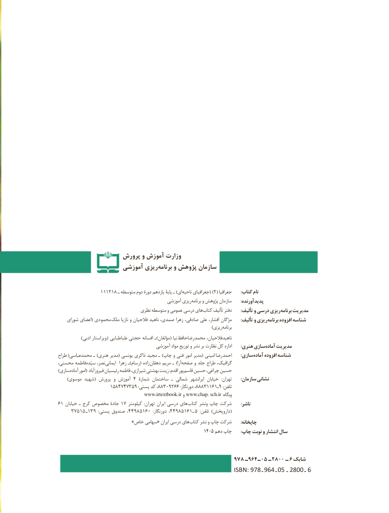

# PDF page 2

پرورش و آموزش وزارت
                   آموزشی ریزی‌برنامه و پژوهش سازمان

                111218 ـ متوسطه دوم دورۀ یازدهم پایۀ ـ )ای )ناحیه جغرافیای( 2( جغرافیا       :کتاب نام
                                               آموزشی ریزی برنامه و پژوهش سازمان       :پدیدآورنده
                                نظری متوسطه و عمومی درسی های کتاب تألیف دفتر : تألیف و درسی ریزی برنامه مدیریت
    شورای اعضای( محمودی  ملک نازیا و فالحیان ناهید صمدی، زهرا صادقی، علی افشار، مژگان       :تألیف و ریزی برنامه افزوده شناسه
                          ) ریزیبرنامه
) ادبی ویراستار( طباطبایی حجتی افسانه ـ)مؤلفان( نیا محمدرضاحافظ ناهیدفالحیان،
                                          آموزشی مواد توزیع و نشر بر نظارت کلّ اداره       :هنری سازیآماده‌    مدیریت
طراح (محمدعباسی ـ )هنری مدیر( یونسی ذاکری مجید ـ )چاپ و فنی امور مدیر( امینی  رضا احمد : سازی آماده افزوده شناسه
محسنی، فاطمه سیّده نصر، ایمانی  زهرا ـ)رسام( زاده دهقان مریم ـ )آرا صفحه و جلد طراح گرافیک،
) سازی آماده امور( فیروزآباد رئیسیان فاطمه شیرازی، بهشتی زینت اقدم، پور قاسم حسین چراغی، حسین
     )موسوی شهید( پرورش و آموزش ٤ شمارۀ ساختمان ـ شمالی  ایرانشهر خیابان   :تهران       :سازمان نشانی
    ١٥٨،٩٥٣٧٤٧٤٨٨٩٠٣٢،:پستی کد    ٦٦٨٨٨٣١١٦١تلفن:دورنگار          ٩ـ :
                                       www.irtextbook.ir و www.chap. sch.ir :وبگاه
٦ ١ خیابان١هایـ کرج مخصوص جادۀ  ٧ کیلومتر  :تهران ایران درسی       کتاب ونشر چاپ شرکت       :ناشر
     ٥٧٣١٥ ـ١ ٩٣  :پستی صندوق  ، 944 85160  :دورنگار٨٥١٦١٩٤٤،          ـ (٥  :تلفن )داروپخش
  » خاص سهامی« ایران درسی های کتاب نشر و چاپ شرکت       :چاپخانه
                   :1405دهم چاپ   چاپ نوبت و انتشار سال

                                                                        978  ـ 964 ـ 05   ـ 2800 ـ  6 شابك
                                                           ISBN: 978  ـ 964  ـ 05    ـ 2800   ـ 6

