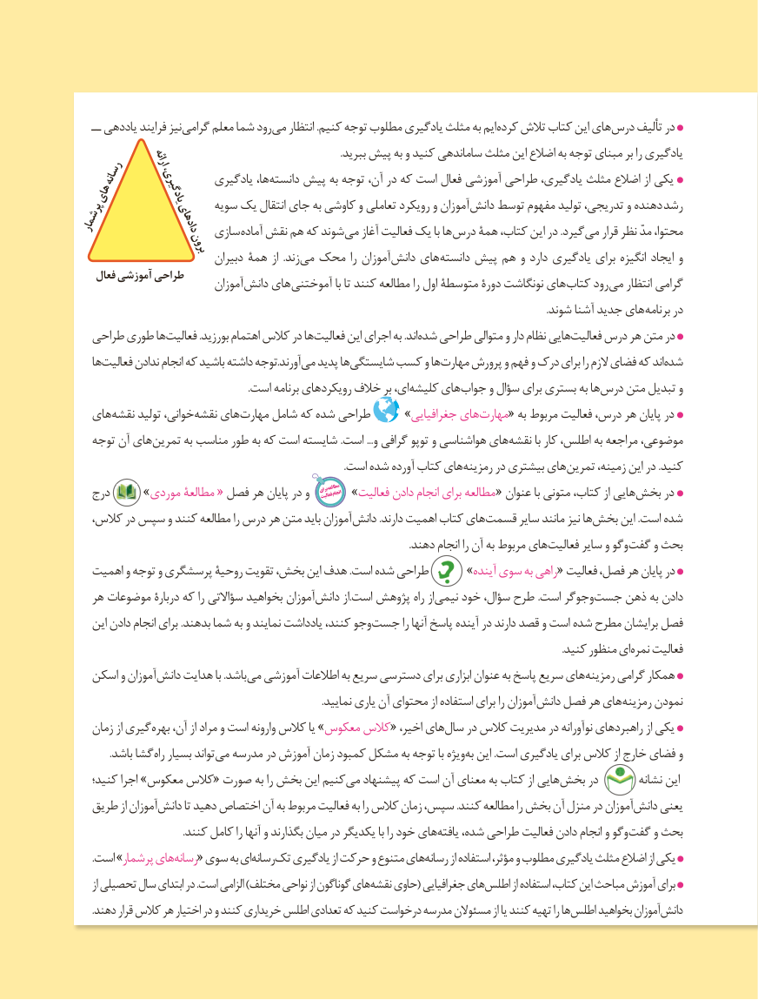

# PDF page 7

ــ یاددهی فرایند نیز گرامی معلم شما رود می انتظار .کنیم توجه مطلوب یادگیری مثلث به ایم کرده تالش کتاب این های درس تألیف در
             ارائه                                                                .ببرید پیش به و کنید ساماندهی مثلث این اضالع به توجه مبنای بر را یادگیری
    رسانه                یادگیری ها، دانسته پیش به توجه آن، در که است فعال آموزشی طراحی یادگیری، مثلث اضالع از یکی های         یادگیری،
پرشمار            دادهای سویه یک انتقال جای به کاوشی و تعاملی رویکرد و آموزان دانش توسط مفهوم تولید تدریجی، و دهنده رشد                     سازی آماده نقش هم که شوند می آغاز فعالیت یک با ها درس همۀ کتاب، این در .گیرد می قرار نظر مدّ محتوا،               برون
                             دبیران همۀ از  .زند می محک را آموزان دانش های دانسته پیش هم و دارد یادگیری برای انگیزه ایجاد و
    فعال آموزشی طراحی                            آموزان دانش های آموختنی با تا کنند مطالعه را اول متوسطۀ دورۀ نونگاشت های کتاب رود می انتظار گرامی
                                                                                                                                                                                         .شوند آشنا جدید های برنامه در
   طراحی طوری ها فعالیت .بورزید اهتمام کالس در ها فعالیت این اجرای به .اند شده طراحی متوالی و دار نظام هایی فعالیت درس هر متن در
   ها فعالیت ندادن انجام که باشید داشته توجه.آورند می پدید ها شایستگی کسب و ها مهارت پرورش و فهم و درک برای را الزم فضای که اند شده
     . است برنامه هایرویکرد خالف بر ای، کلیشه های جواب و سؤال برای بستری به ها درس متن تبدیل و
   های نقشه تولید خوانی، نقشه های مهارت شامل که شده طراحی     »جغرافیایی های مهارت« به مربوط فعالیت درس، هر پایان در
   توجه آن های تمرین به مناسب طور به که است شایسته .است ...و گرافی توپو و هواشناسی های نقشه با کار اطلس، به مراجعه موضوعی،
    . است شده آورده کتاب هایرمزینه در بیشتری های تمرین زمینه، این در .کنید

                                                                                                                 انجام                                          »فعالیت دادن انجام برای مطالعه « عنوان با متونی کتاب، از هایی بخش در   درج       » موردی مطالعۀ « فصل هر پایان در و   برایفعالیتمطالعه
،آموزانکالس در سپس و کنند مطالعه را درس هر متن باید         دانش .دارند اهمیت کتاب های قسمت سایر مانند نیز ها بخش این .است شده
     . دهند انجام را آن به مربوط هایفعالیت سایر و وگو گفت و بحث
   اهمیت و توجه و پرسشگری روحیۀ تقویت بخش، این هدف .است شده طراحی      »آینده سوی به راهی « فعالیت فصل، هر پایان در
   هر موضوعات دربارۀ که را سؤاالتی بخواهید آموزان دانش از.است پژوهش راه از نیمی خود سؤال، طرح .است وجوگر جست ذهن به دادن
   این دادن انجام برای .بدهند شما به و نمایند یادداشت کنند، وجو جست را آنها پاسخ آینده در دارند قصد و است شده مطرح برایشان فصل
             . کنید منظور اینمره فعالیت
   اسکن و آموزان دانش هدایت با .باشد می آموزشی اطالعات به سریع دسترسی برای ابزاری عنوان به پاسخ سریع های رمزینه گرامی همکار
                                                                                                 .نمایید یاری آن محتوای از استفاده برای را آموزان دانش فصل هر های رمزینه نمودن
   زمان از گیری بهره آن، از مراد و است وارونه کالس یا »معکوس کالس« اخیر، های سال در کالس مدیریت در نوآورانه راهبردهای از یکی
             .باشد گشا راه بسیار تواند می مدرسه در آموزش زمان کمبود مشکل به توجه با ویژه به این .است یادگیری برای کالس از خارج فضای و
   کنید؛ اجرا »معکوس کالس« صورت به را بخش این کنیم می پیشنهاد که است آن معنای به کتاب از هایی بخش در        نشانه این
   طریق از آموزان دانش تا دهید اختصاص آن به مربوط فعالیت به را کالس زمان سپس، .کنند مطالعه را بخش آن منزل در آموزان دانش یعنی
 . کنند کامل را آنها و بگذارند میان در یکدیگر با را خود هاییافته شده، طراحی فعالیت دادن انجام و وگو گفت و بحث
       .است »پرشمار هایرسانه        « سوی به ایرسانه   تک    یادگیری از حرکت و متنوع هایرسانه        از استفاده مؤثر، و مطلوب یادگیری مثلث اضالع از یکی
     از تحصیلی سال ابتدای در .است الزامی )مختلف نواحی از گوناگون های نقشه حاوی( جغرافیایی های اطلس از استفاده کتاب، این مباحث آموزش برای
       .دهند قرار کالس هر اختیار در و کنند خریداری اطلس تعدادی که کنید درخواست مدرسه مسئوالن از یا کنند تهیه را ها اطلس بخواهید آموزان دانش
                                   7

