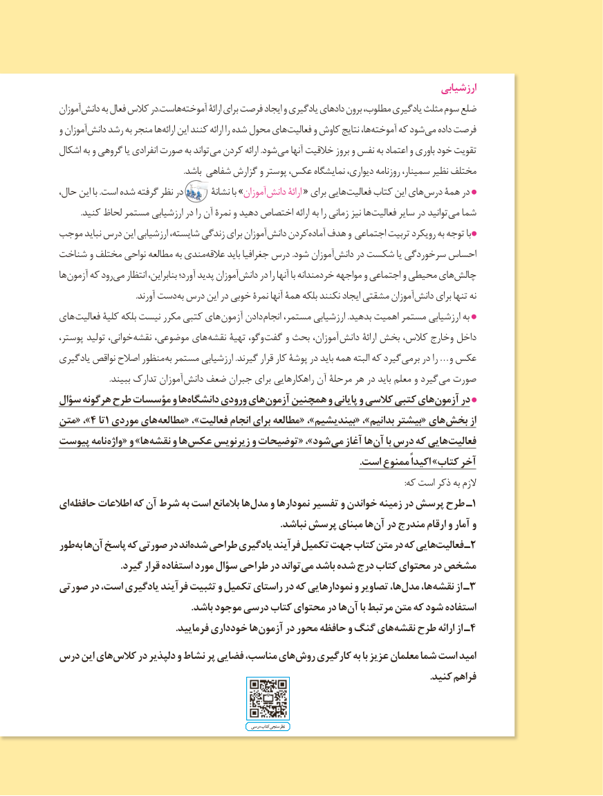

# PDF page 8

ارزشیابی
                آموزان دانش به فعال کالس در.هاست آموخته ارائۀ برای فرصت ایجاد و یادگیری دادهای برون مطلوب، یادگیری مثلث سوم ضلع
               و آموزان دانش رشد به منجر ها ارائه این کنند ارائه را شده محول های فعالیت و کاوش نتایج ها، آموخته که شود می داده فرصت
             اشکال به و گروهی یا انفرادی صورت به تواند می کردن ارائه .شود می آنها خالقیت بروز و نفس به اعتماد و باوری خود تقویت
                                                                                            .باشد شفاهی گزارش و پوستر عکس، نمایشگاه دیواری، روزنامه سمینار، نظیر مختلف
             حال، این با .است شده گرفته نظر در       نشانۀ با »آموزان دانش ارائۀ « برای هایی فعالیت کتاب این های درس همۀ در
                                        .کنید لحاظ مستمر ارزشیابی در را آن نمرۀ و دهید اختصاص ارائه به را زمانی نیز ها فعالیت سایر در توانید می شما
          موجب نباید درس این ارزشیابی شایسته، زندگی برای آموزان دانش کردن آماده هدف و اجتماعی تربیت رویکرد به توجه با
          شناخت و مختلف نواحی مطالعه به مندی عالقه باید جغرافیا درس .شود آموزان دانش در شکست یا سرخوردگی احساس
               ها آزمون که رود می انتظار بنابراین، آورد؛ پدید آموزان دانش در را آنها با خردمندانه مواجهه و اجتماعی و محیطی های چالش
      . آورند دستبه درس این در خوبی نمرۀ آنها همۀ بلکه نکنند ایجاد مشقتی آموزان دانش برای تنها نه
           های فعالیت کلیۀ بلکه نیست مکرر کتبی های آزمون دادن انجام مستمر، ارزشیابی .بدهید اهمیت مستمر ارزشیابی به
      ،خوانی،پوستر تولید          نقشه موضوعی، های نقشه تهیۀ وگو، گفت و بحث آموزان، دانش ارائۀ بخش کالس، وخارج داخل
             یادگیری نواقص اصالح منظور به مستمر ارزشیابی .گیرند قرار کار پوشۀ در باید همه البته که گیرد برمی در را …و عکس
   . ببیند تدارک آموزان دانش ضعف جبران برای راهکارهایی آن مرحلۀ هر در باید معلم و گیرد می صورت
           سؤال هرگونه طرح مؤسسات و ها دانشگاه ورودی های آزمون همچنین و پایانی و کالسی کتبی های آزمون در
          متن« ،»4 تا1 موردی های مطالعه« ، »فعالیت انجام برای مطالعه « ،»بیندیشیم« ،»بدانیم بیشتر« های بخش از
          پیوست نامه واژه « و »ها نقشه و ها عکس زیرنویس و توضیحات « ،»شود می آغاز ها آن با درس که هایی فعالیت
                                                                                                                                               .است ممنوع اکیداً »کتاب آخر
                                                                                                                                                                                                       :که است ذکر به الزم
           ای حافظه اطالعات که آن شرط به است بالمانع ها مدل١و نمودارها تفسیر و خواندن زمینه در پرسش طرح ـ
                                                                                                                .نباشد پرسش مبنای ها آن در مندرج ارقام و آمار و
           طور به ها آن پاسخ که صورتی در اند شده طراحی یادگیری فرآیند تکمیل جهت کتاب متن در که هایی فعالیت٢ـ
                                                .گیرد قرار استفاده مورد سؤال طراحی در تواند می باشد شده درج کتاب محتوای در مشخص
          صورتی در است، یادگیری فرآیند تثبیت و تکمیل راستای در که نمودارهایی و تصاویر ها، مدل ها، نقشه٣از ـ
                                                                            .باشد موجود درسی کتاب محتوای در ها آن با مرتبط متن که شود استفاده
    . فرمایید خودداری هاآزمون در محور حافظه و گنگ های نقشه٤طرح ارائه از ـ
        درس این های کالس در دلپذیر و نشاط پر فضایی مناسب، های روش کارگیری به با عزیز معلمان شما است امید
                                                                                                                                                                            .کنید فراهم

                                                                                                        درسی کتاب نظرسنجی
                                            8

