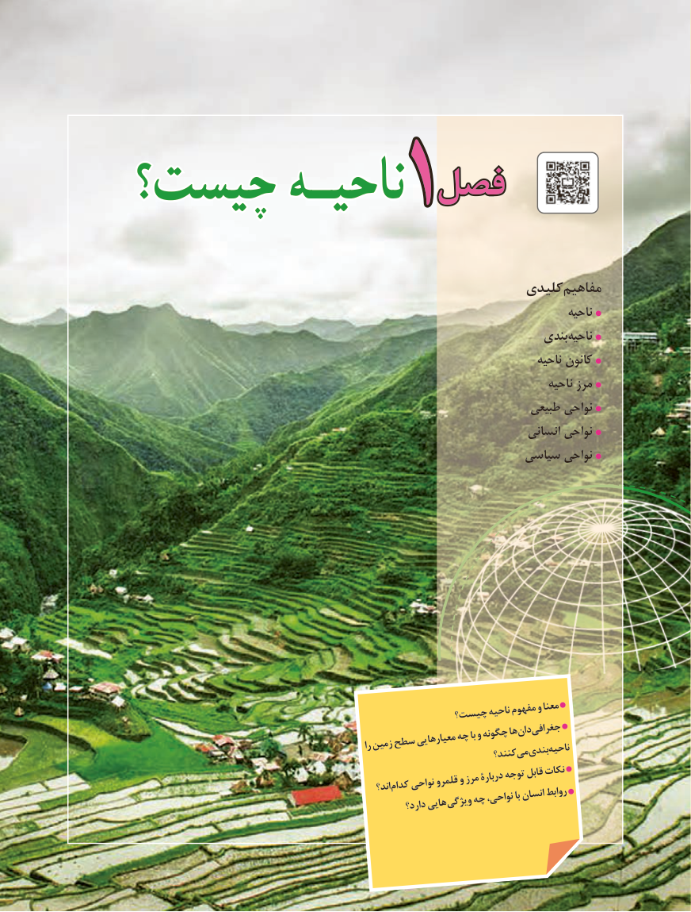

# PDF page 9

فصلفصلچیست؟چیست؟ ناحیـهناحیـه      1

                                                    کلیدیمفاهیم
                                                                                       ناحیه
                                                                   بندی‌ناحیه
                                                                                 ناحیه کانون
                                                                                   ناحیه مرز
                                                                 طبیعی نواحی
                                                                        انسانی نواحی
                                                      سیاسی نواحی

                                              چیست؟ناحیهمفهومومعنا
                                             چهباوچگونههادان‌  جغرافی‌                                                             معیارهایی                                                      رازمینسطح                                                                      کنند؟می‌ بندیناحیه‌
                                                         اند؟ کدامنواحیقلمروومرزدربارۀتوجهقابلنکات
                                                            دارد؟هایی ویژگیچهنواحی،باانسانروابط

                                          1

