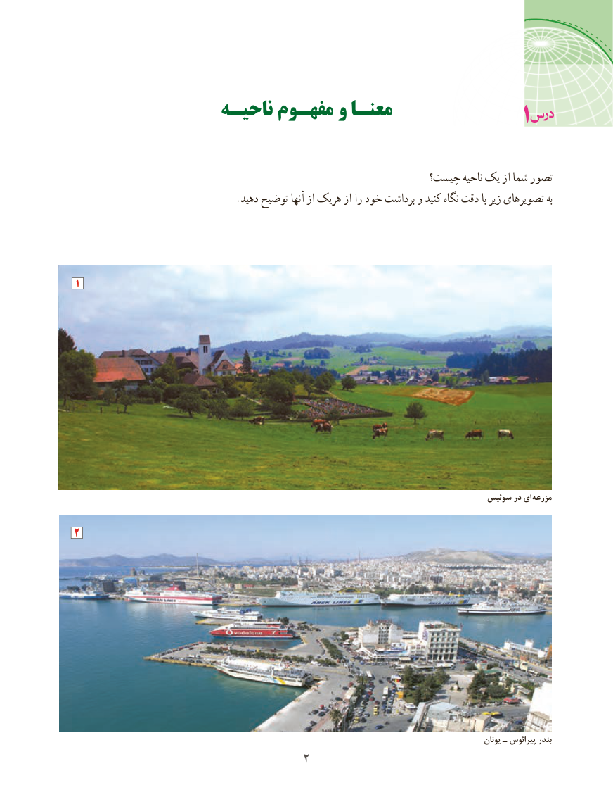

# PDF page 10

ناحیـه مفهـوم و معنـا                                                   1

                                                          چیست؟ ناحیه یک از شما تصور
                                 .دهید توضیح آنها از هریک از را خود برداشت و کنید نگاه دقت با زیر تصویرهای به

1

                                                                                    سوئیس در ای مزرعه

2

                                                                                                                         یونان ـ پیرائوس بندر
                                     2

