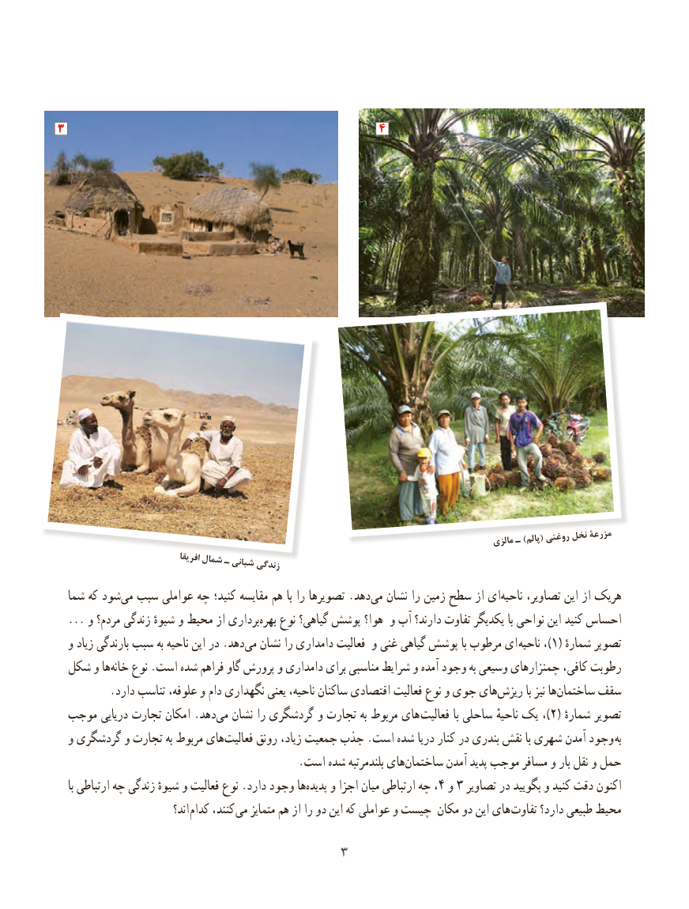

# PDF page 11

3                                                4

                                                                                                   مالزی ـ )پالم( روغنی نخل مزرعۀ
                                 افریقا شمال ـ شبانی زندگی
  شما که شودمی‌  سبب عواملی چه کنید؛ مقایسه هم با را تصویرها .دهد‌می نشان را زمین سطح از ای‌ناحیه تصاویر، این از هریک
  ... و مردم؟ زندگی شیوهٔ و محیط از برداری‌بهره نوع گیاهی؟ پوشش هوا؟ و آب دارند؟ تفاوت یکدیگر با نواحی این کنید احساس
  و زیاد بارندگی سبب به ناحیه این در .دهد ‌می نشان را دامداری فعالیت و غنی گیاهی پوشش با مرطوب ای )ناحیه ، 1( ٔتصویرشماره
 شکل و ها ‌خانه نوع .است شده فراهم گاو پرورش و دامداری برای مناسبی شرایط و آمده وجود به وسیعی چمنزارهای کافی، رطوبت
.‌دارد تناسب علوفه، و دام نگهداری یعنی ناحیه، ساکنان اقتصادی فعالیت نوع و جوی هایریزش با نیز هاساختمان‌     سقف
 موجب دریایی تجارت امکان .دهدمی‌  نشان را گردشگری و تجارت به مربوط های )فعالیت با ساحلی ناحیهٔ یک ، 2( شمارهٔتصویر
  و گردشگری و تجارت به مربوط های‌فعالیت رونق زیاد، جمعیت جذب .است شده دریا کنار در بندری نقش با شهری آمدن وجود به
                                            .است شده بلندمرتبه هایساختمان‌       آمدن پدید موجب مسافر و بار نقل و حمل
    با ارتباطی چه زندگی شیوهٔ و فعالیت نوع .دارد وجود ها‌پدیده و اجزا میان ارتباطی چه ،4 و 3 تصاویر در بگویید و کنید دقت اکنون
                             اند؟ کدام کنند، می متمایز هم از را دو این که عواملی و چیست مکان دو این های تفاوت دارد؟ طبیعی محیط

                                   3

