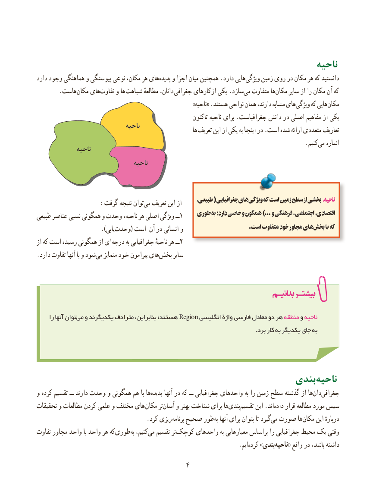

# PDF page 12

ناحیه
دارد وجود هماهنگی و پیوستگی نوعی مکان، هر هایپدیده‌    و اجزا میان همچنین .دارد هاییویژگی‌     زمین روی در مکان هر که دانستید
       .هاست‌مکان هایتفاوت‌     و ها شباهت مطالعهٔ دانان، جغرافی ازکارهای یکی .سازدمی‌  متفاوت هامکان‌     سایر از را مکان آن که
                                                             »ناحیه« .هستند نواحی همان دارند، مشابه هایویژگی‌     که هاییمکان‌
                                                              تاکنون ناحیه برای .جغرافیاست دانش در اصلی مفاهیم از یکی
                               ناحیه                                                                 ها تعریف این از یکی به اینجا در .است شده ارائه متعددی تعاریف
                                     .‌کنیم می اشاره              ناحیه
                                  ناحیه

            ،هایطبیعی( جغرافیایی    ویژگی‌     که است زمین سطح از بخشی ، ناحیه   :‌گرفت نتیجه توانمی تعریف این از
طبیعی عناصر نسبی همگونی و وحدت ناحیه، هر اصلی ویژگی ــ1    طوری به دارد؛ خاصی و همگون ...) و فرهنگی ، اجتماعی اقتصادی،
                         .)یابی‌وحدت( است آن در انسانی و                            .است متفاوت خود مجاور هایبخش‌      با که
از که است رسیده همگونی از ای ‌درجه به جغرافیایی ناحیهٔ هر ــ2
.دارد تفاوت آنها با و شود‌می متمایز خود پیرامون های ‌بخش سایر

     را آنها توانمی‌  و یکدیگرند مترادف بنابراین، هستند؛ Region انگلیسی واژۀ فارسی معادل دو هر منطقه و ناحیه
                                                                                                                .برد کار به یکدیگر جای به

                                                  بندی‌ناحیه
و کرده تقسیم ــ دارند وحدت و همگونی هم با هاپدیده‌      آنها در که ــ جغرافیایی واحدهای به را زمین سطح گذشته از ها‌دان‌جغرافی
تحقیقات و مطالعات کردن ‌علمی و مختلف های  مکان تر‌آسان و بهتر شناخت برای ها‌بندی ‌تقسیم این .اند‌داده قرار مطالعه مورد سپس
        . کرد ریزی برنامه صحیح طور به آنها برای بتوان تا گیردمی‌  صورت ها ‌مکان این دربارهٔ
تفاوت مجاور واحد با واحد هر که‌طوری‌به کنیم،می‌  تقسیم تر‌کوچک واحدهای به معیارهایی براساس را جغرافیایی محیط یک وقتی
                                     .‌ایمکرده »بندیناحیه‌     « واقع در باشد، داشته
                                      4

