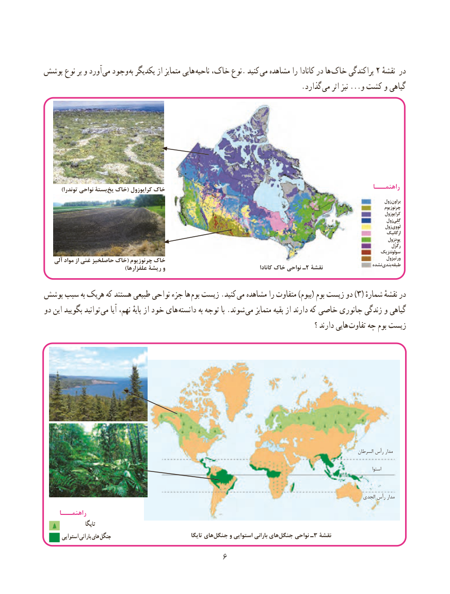

# PDF page 14

پوشش نوع بر و آورد  می وجود به یکدیگر از متمایز هایی ناحیه خاک، نوع. کنید می مشاهده را کانادا در ها  خاک پراکندگی 2 ٔدرنقشه
                       . گذارد می اثر نیز ...و کشت و گیاهی

        )توندرا نواحی بستۀ یخ خاک( کرایوزول خاک                                                                      راهنمـــا
                                                                                                                                                  زول براون
                                                                                                                                                                       چرنوزیوم
                                                                                                                                                   زول کرایو
                                                                                                                                                     زول گِلِی
                                                                                                                                                  زول لووی
                                                                                                                                                                          ارگانیک
                                                                                                                                                                پودزول
                                                                                                                                                                                                                               رگُزُل
                                                                                                                                                       سولونتزیک
    آلی مواد از غنی حاصلخیز خاک( چرنوزیوم خاک                                                                                                            ورتیزول
                                   )علفزارها ریشۀ و                                              کانادا ‌خاک نواحی ـ2 نقشۀ                    نشدهبندی طبقه

پوشش سبب به هریک که هستند طبیعی نواحی جزء ها  بوم زیست .کنید )می مشاهده را متفاوت )بیوم( بوم زیست دو 3( شمارهٔدرنقشهٔ
دو این بگویید توانید  می آیا نهم، پایهٔ از خود های  دانسته به توجه با .شوند می متمایز بقیه از دارند که خاصی جانوری زندگی و گیاهی
                                                                                                    ؟ دارند هایی تفاوت چه بوم زیست

                                                                                                                                            السرطان رأس مدار

                                                                                                                                                                                  استوا

                                                                                                                                  الجدی رأس مدار
     راهنمـــا
                    تایگا
       استوایی بارانی های جنگل                                    تایگا هایجنگل‌     و استوایی بارانی هایجنگل‌     نواحی ـ3 نقشۀ
                                       6

