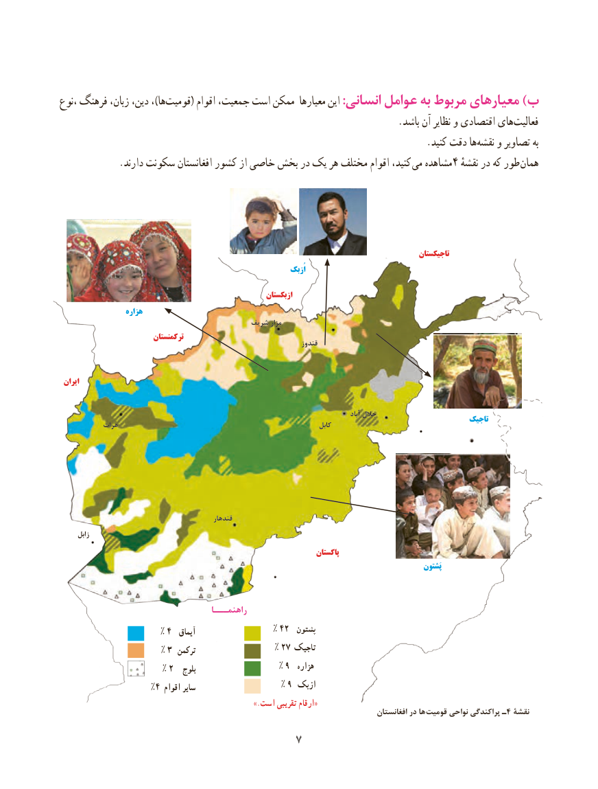

# PDF page 15

،نوع فرهنگ زبان، دین، ،)ها‌قومیت( اقوام جمعیت، است ممکن معیارها این :انسانی عوامل به مربوط معیارهای )ب
      .‌باشد آن نظایر و اقتصادی هایفعالیت
              .‌کنید دقت هانقشه و تصاویر به
            .دارند سکونت افغانستان کشور از خاصی بخش در یک هر مختلف اقوام کنید، می مشاهده4 نقشهٔطوردر که        همان

                                                                                                          تاجیکستان
                                                                           اُزبک

                                                              ازبکستان
                   هزاره
                                            شریف مزار
                            ترکمنستان                                                                          قندوز

 ایران

                                                                                                                  آباد جالل                                                                                                          تاجیک           هرات                                                                 کابل

                                                قندهار
      زابل
                                                                               پاکستان
                                                                                                                         پَشتون

                                      راهنمـــا
                     % 4  آیماق                % 42  پشتون
                     % 3  ترکمن                % 27 تاجیک
                     % 2   بلوچ                 % 9  هزاره
                   %4 اقوام سایر                  % 9 ازبک
                                                              ».است تقریبی ارقام«                                                                                             افغانستان در ها قومیت نواحی پراکندگی ـ4 نقشۀ
                                   7

