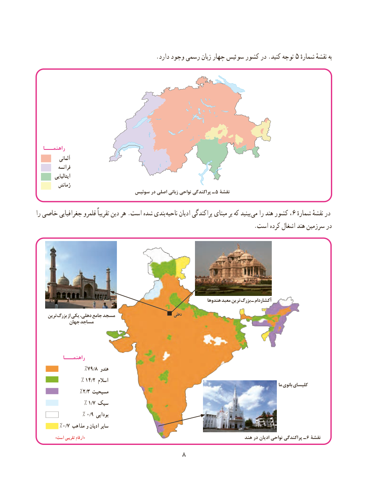

# PDF page 16

.5دارد وجود رسمی زبان چهار سوئیس کشور در .کنید توجه  شمارهٔبهنقشهٔ

   راهنمـــا
            آلمانی
           فرانسه
           ایتالیایی
           رُمانش
                                 سوئیس در اصلی زبانی نواحی پراکندگی ـ 5 نقشۀ

را خاصی جغرافیایی قلمرو تقریباً دین هر .است شده بندی ناحیه ادیان پراکندگی مبنای بر که بینید می را هند کشور ،6 درشماره نقشهٔ
                                                                          .است کرده اشغال هند سرزمین در

                                                                           هندوها معبد ترین بزرگ ـ آکشاردام
     ترین بزرگ از یکی دهلی، جامع مسجد                              دهلی
             جهان مساجد

           راهنمـــا
                  %79/8 هندو
               % 14/2 اسالم                                                                                                                                       ما بانوی کلیسای
                 %2/3 مسیحیت
                % 1/7 سیک
                % 0/9 بودایی
         %0/7 مذاهب و ادیان سایر
              »است تقریبی ارقام«                                                               هند در ادیان نواحی پراکندگی ـ 6 نقشۀ
                                  8

