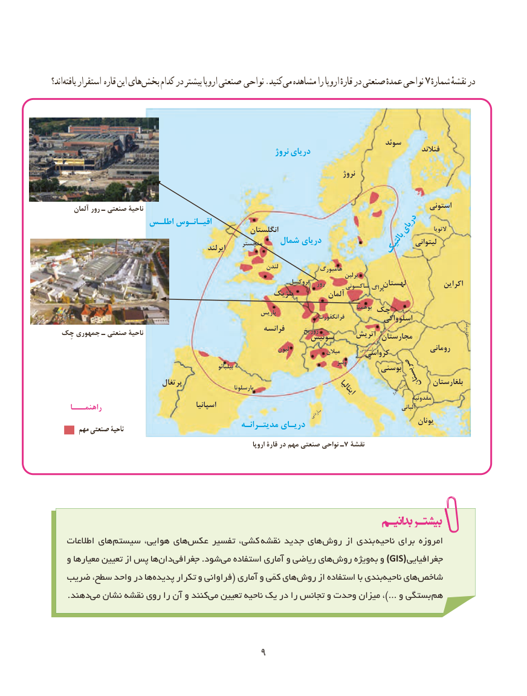

# PDF page 17

اند؟ یافته استقرار قاره این های بخش کدام در بیشتر اروپا صنعتی نواحی .کنید می مشاهده را اروپا قارهٔ در صنعتی عمدهٔ نواحی 7 شمارهٔدرنقشهٔ

                                                                                  سوئد                                                                نروژ دریای                                    فنالند
                                                                                            نروژ

       آلمان رور ـ صنعتی ناحیۀ                                                                             استونی
                    اطلـس اقیـانـوس                                                        انگلستان                       دریای      التویا
                                                        منچستر    شمال دریای                              لیتوانی                                                    ایرلند                                  بالتیک
                                                                      لندن             هامبورگ                                                                                                              برلین
                                                                       بروکسل   رور      ساکسونی پراگلهستان           اکراین                                                        بلژیک          آلمان
                                                                                                                      بوهمیا چک                                                                 پاریس                                                                                           فرانکفورت           اسلوواکی
                                                            فرانسه      زوریخ کِناحیۀچ جمهوری ـ صنعتی                                                       سوئیس     اتریش مجارستان                                            مولداوی
                                                                                                              رومانی                                                                               لیون             میالن                                                                                                                                                                       اسلوونیکرواسی
                                                                                                                   ونیز                                                                             بیلبائو                                    بوسنی
                                 پرتغال                                                                                           صربستان  بلغارستان                                                                            بارسلونا                                                              مونته                                                                                      ایتالیا            نگرو                                                                                                                                  مقدونیه
                                                  اسپانیا                                                                            آلبانی     راهنمـــا                                                                                                           ساردنی                                                                                                                 یونان                                                   مدیتـرانـه دریـای        مهم صنعتی ناحیۀ
                                                                                  اروپا قارۀ در مهم صنعتی نواحی ـ7 نقشۀ

    اطالعات های ‌سیستم هوایی، های ‌عکس تفسیر کشی،  ‌نقشه جدید های‌روش از بندی  ناحیه برای امروزه
    و معیارها تعیین از پس هان‌  ‌دا‌جغرافی .شود‌می استفاده آماری و ریاضی های ‌روش ویژه‌)به و GIS( جغرافیایی
   ضریب سطح، واحد در ها ‌پدیده تکرار و فراوانی( آماری و کمّی های‌روش از استفاده با بندی‌ناحیه های‌شاخص
 .‌دهند می نشان نقشه روی را آن و کنند‌می تعیین ناحیه یک در را تجانس و وحدت میزان ،...) و بستگی هم

                                        9

