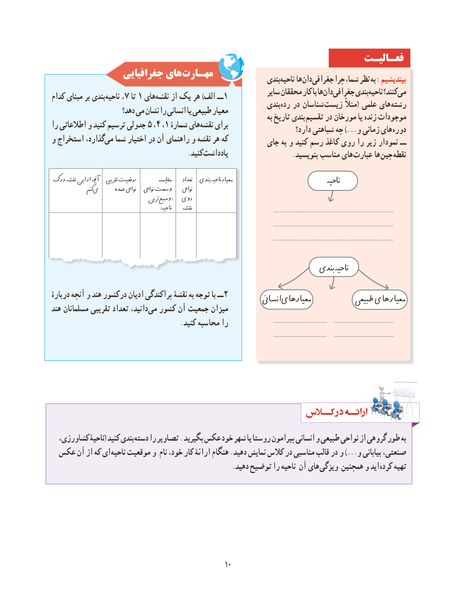

# PDF page 18

فعـالیـت
                جغرافیایی هایمهـارت‌                                                                بندیناحیه‌     ها دانجغرافی‌      چرا ،شما نظر به :بیندیشیم
                                                                 سایر محققان کار با هادان‌  جغرافی‌      بندیناحیه‌     کنند؟می‌کدام مبنای بر بندی ناحیه ،7 تا 1 های نقشه از یک هر )الف ــ 1                                                               بندیرده‌   در شناسان زیست مثال( علمی های رشته                      دهد؟ می نشان را انسانی یا طبیعی معیار                                                                               به تاریخ بندی تقسیم در مورخان یا زنده موجوداترا اطالعاتی و کنید ترسیم جدولی 5 ،4 ،1‌شمارۀ هاینقشه‌    برای                                                                              دارد؟ شباهتی چه )...و زمانی های دوره
و استخراج ،گذاردمی‌  شما اختیار در آن راهنمای و نقشه هر که                                                     جای به و کنید رسم کاغذ روی را زیر نمودار ــ
                                        .کنید داشت یاد                   .بنویسید مناسب های عبارت ها چین نقطه
درک نقشه این از آچنه   تقرییبومقعیت         مقایسه     تعداد  بندیناحیهمعیار                                ناحیه               کنمیم‌        عمده نوایح   نوایح وسعت    نوایح
                                   ترینوسیع‌        (   روی
                                                                                     ) ناحیه    نقشه                                                ................................................................................................................................................
                                                                                                                                     ................................................................................................................................................
                                                                                                                                     ................................................................................................................................................

                                                                   بندیناحیه‌
دربارۀ آنچه و هند درکشور ادیان پراکندگی نقشۀ به توجه با ــ2                                                                                                                                                                                                                                           انساینمعیارهای           طبیعیطبیعی معیارهایهند مسلمانان تقریبی تعداد ،دانید‌می کشور آن جمعیت میزان
                                      .کنید محاسبه را                           ................................................................    ........................................................................
                                                                                                                                      ................................................................    ........................................................................

  ،کشاورزی ناحیۀ( کنید بندی دسته را تصاویر . بگیرید عکس خود شهر یا روستا پیرامون انسانی و طبیعی نواحی از گروهی طور به
 عکس آن از که ای ناحیه موقعیت و نام ،خود کار ارائۀ هنگام .دهید نمایش کالس در مناسبی قالب در و )...و بیابانی ،صنعتی
                                                     .دهید توضیح را ناحیه آن های ویژگی همچنین و اید کرده تهیه

                                                                                                         1010

