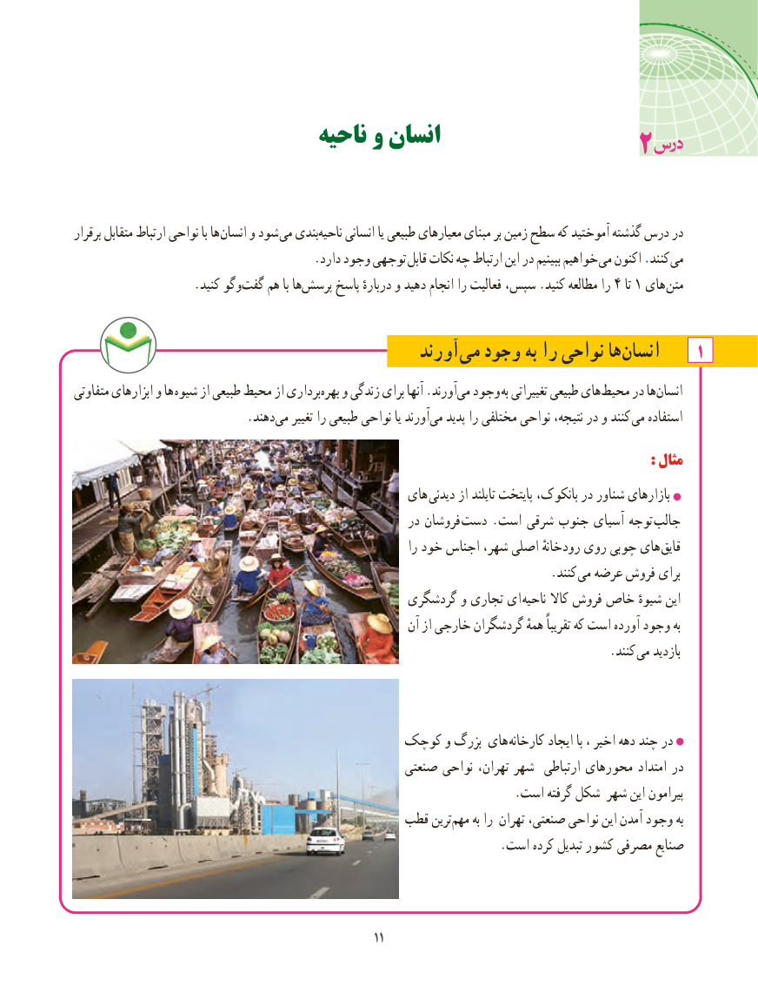

# PDF page 19

ناحیه و انسان                                        2

برقرار متقابل ارتباط نواحی با ها انسان و شود می بندیناحیه‌     انسانی یا طبیعی معیارهای مبنای بر زمین سطح که آموختید گذشته درس در
                                        .دارد وجود توجهی قابل نکات چه ارتباط این در ببینیم خواهیم می اکنون .کنند می
     .‌کنید وگوگفت هم با هاپرسش‌     پاسخ دربارهٔ و دهید انجام را فعالیت سپس، .کنید مطالعه را 4 تا 1 های متن

                                            آورند ‌می وجود به را نواحی ها‌انسان      1
متفاوتی ابزارهای و ها  شیوه از طبیعی محیط از برداری ‌بهره و زندگی برای آنها .آورندمی‌  وجود  به تغییراتی طبیعی های ‌محیط در هاانسان‌
           .‌دهند می تغییر را طبیعی نواحی یا آورند‌می پدید را مختلفی نواحی نتیجه، در و کنند  می استفاده
                                                                                                                        :: مثالمثال
                                                  های دیدنی از تایلند پایتخت بانکوک، در شناور بازارهای
                                                        در فروشان  دست . است شرقی جنوب آسیای توجه  جالب
                                                                    را خود اجناس شهر، اصلی رودخانهٔ روی چوبی های قایق
                                . کنند می عرضه فروش برای
                                                گردشگری و تجاری ای ناحیه کاال فروش خاص شیوهٔ این
                                                            آن از خارجی گردشگران همهٔ تقریباً که است آورده وجود به
                                                                                        .کنند می بازدید

                                    کوچک و بزرگ های کارخانه ایجاد با ، اخیر دهه چند در
                                                   صنعتی نواحی تهران، شهر  ارتباطی محورهای امتداد در
                                                                        .است گرفته شکل شهر این پیرامون
                                          قطب ترین‌مهم به را تهران صنعتی، نواحی این آمدن وجود به
                                                                      .است کرده تبدیل کشور مصرفی صنایع

                                                                                                               1111

