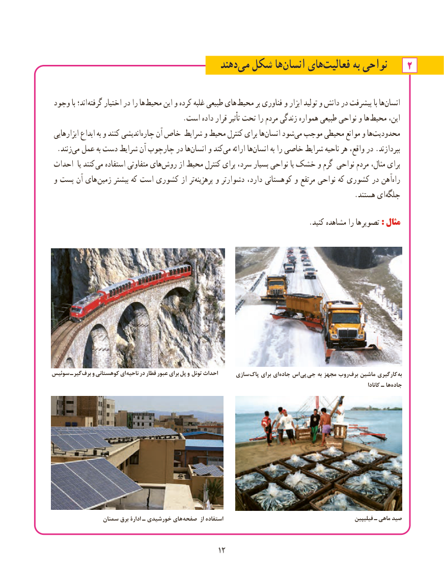

# PDF page 20

دهند‌می شکل ها‌انسان های‌فعالیت به نواحی    2

 وجود با اند؛ گرفته اختیار در را هامحیط‌      این و کرده غلبه طبیعی های محیط بر فناوری و ابزار تولید و دانش در پیشرفت با ها‌انسان
 . است داده قرار تأثیر تحت را مردم زندگی همواره طبیعی نواحی و ها محیط این،
 ابزارهایی ابداع به و کنند اندیشی ‌چاره آن خاص شرایط و محیط کنترل برای ها ‌انسان شود‌می موجب محیطی موانع و ها ‌محدودیت
 .‌زنندمی عمل به دست شرایط آن چارچوب در هاانسان‌    و کندمی‌   ارائه ها‌انسان به را خاصی شرایط ناحیه هر واقع، در .بپردازند
 احداث  یا کنند می استفاده متفاوتی های ‌روش از محیط کنترل برای سرد، بسیار نواحی یا خشک و گرم نواحی مردم مثال، برای
 و پست آن های  زمین بیشتر که است کشوری از تر ‌پرهزینه و دشوارتر دارد، کوهستانی و مرتفع نواحی که کشوری در آهن ‌راه
                  .‌هستند ای جلگه

         . کنید مشاهده را ها تصویر :: مثالمثال

سوئیس ـ گیر برف و کوهستانی ای ناحیه در قطار عبور برای پل و تونل احداث     سازی  پاک برای ای ‌جاده اس پی جی به مجهز روب‌برف ماشین کارگیری به
                                                                                                                                                             کانادا ـ هاجاده‌

                سمنان برق ادارۀ ـ خورشیدی های صفحه  از استفاده                                                  فیلیپین ـ ماهی صید

                                            1212

