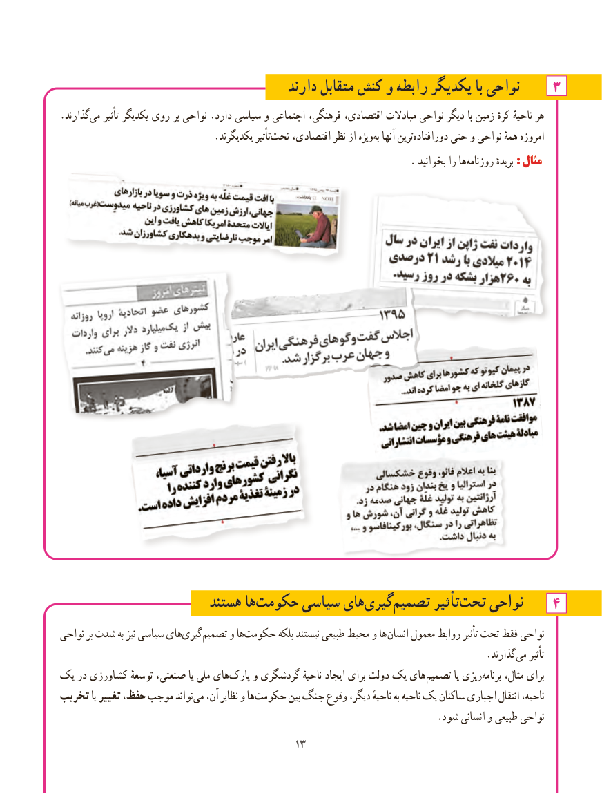

# PDF page 21

دارند متقابل کنش و رابطه یکدیگر با نواحی۳
.گذارند‌می تأثیر یکدیگر روی بر نواحی .دارد سیاسی و اجتماعی فرهنگی، اقتصادی، مبادالت نواحی دیگر با زمین کرهٔ ناحیهٔ هر
     .‌یکدیگرند تأثیرتحت اقتصادی، نظر از ویژهبه‌  آنها تریندورافتاده‌      حتی و نواحی همهٔ امروزه
            .‌بخوانید را هاروزنامه بریدهٔ :: مثالمثال

                       هستند هاحکومت‌      سیاسی هایگیری‌       ‌تصمیم تأثیر ‌تحت نواحی    4
نواحی بر شدت به نیز سیاسی هایگیری‌       ‌تصمیم و هاحکومت‌        بلکه نیستند طبیعی محیط و ها انسان معمول روابط تأثیر تحت فقط نواحی
                          .‌گذارندمی تأثیر
یک در کشاورزی توسعهٔ صنعتی، یا ملی های‌پارک و گردشگری ناحیهٔ ایجاد برای دولت یک های تصمیم یا ریزیبرنامه‌     مثال، برای
تخریب یا تغییر حفظ، موجب تواند‌می آن، نظایر و ها‌حکومت بین جنگ وقوع دیگر، ناحیهٔ به ناحیه یک ساکنان اجباری انتقال ناحیه،
                                                                              .شود انسانی و طبیعی نواحی
                                          1313

