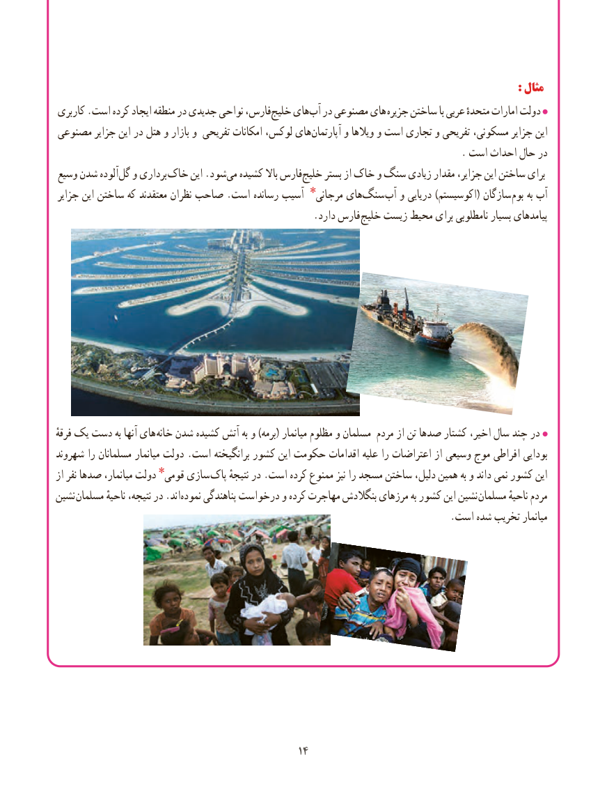

# PDF page 22

:: مثالمثال
کاربری .است کرده ایجاد منطقه در جدیدی نواحی فارس،خلیج‌    های ‌آب در مصنوعی های  جزیره ساختن با عربی متحدهٔ امارات دولت
مصنوعی جزایر این در هتل و بازار و تفریحی امکانات لوکس، هایآپارتمان‌      و ویالها و است تجاری و تفریحی مسکونی، جزایر این
                                                                                   . است احداث حال در
وسیع شدن آلوده ‌گل و برداری خاک این .شود ‌می کشیده باال فارس‌خلیج بستر از خاک و سنگ زیادی مقدار جزایر، این ساختن برای
جزایر این ساختن که معتقدند نظران صاحب .است رسانده آسیب مرجانی٭ های ‌سنگ  آب و دریایی )اکوسیستم( سازگان بوم به آب
          . دارد فارس خلیج زیست محیط برای نامطلوبی بسیار پیامدهای

ٔهایفرقه یک دست به آنها        خانه شدن کشیده آتش به و )برمه( میانمار مظلوم و مسلمان مردم از تن صدها کشتار اخیر، سال چند در
شهروند را مسلمانان میانمار دولت .است برانگیخته کشور این حکومت اقدامات علیه را اعتراضات از وسیعی موج افراطی بودایی
از نفر صدها میانمار، دولت قومی٭ سازی پاک نتیجهٔ در .است کرده ممنوع نیز را مسجد ساختن دلیل، همین به و داند نمی کشور این
نشین مسلمان ناحیهٔ نتیجه، در .اند ‌نموده پناهندگی درخواست و کرده مهاجرت بنگالدش مرزهای به کشور این نشین مسلمان ناحیهٔ مردم
                                                                                 .است شده تخریب میانمار

                                              1414

