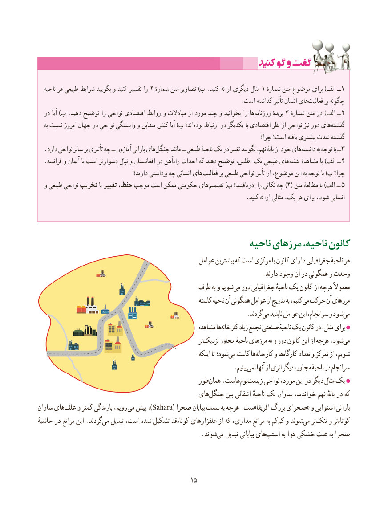

# PDF page 23

ناحیه هر طبیعی شرایط بگویید و کنید تفسیر را 2 مثالشماره متن تصاویر )ب .کنید ارائه دیگری    1 شمارهٔــمتن موضوع برای )الف  1
                                                                      .است گذاشته تأثیر انسان هایفعالیت‌        بر چگونه
  در آیا )ب .دهید توضیح را نواحی اقتصادی روابط و مبادالت از مورد چند و بخوانید را ها روزنامه بریدهٔ 3 ٔــشماره متن در )الف  2
    به نسبت امروز جهان در نواحی وابستگی و متقابل کنش آیا )پ اند؟‌بوده ارتباط در یکدیگر با اقتصادی نظر از نواحی نیز دور های‌گذشته
                                                                                   چرا؟ است؟ یافته بیشتری شدت گذشته
.‌دارد نواحی سایر بر تأثیری چه ــ آمازون بارانی هایجنگل مانند ــ طبیعی ناحیهٔ یک در تغییر بگویید نهم، پایهٔ از خود هایدانسته‌        ‌به توجه با ــ3
  .فرانسه و آلمان یا است دشوارتر نپال و افغانستان در آهن ‌راه احداث که دهید توضیح اطلس، یک طبیعی های  نقشه مشاهدهٔ با )الف ــ4
                                         دارید؟ برداشتی چه انسانی های فعالیت بر طبیعی نواحی تأثیر از موضوع، این به توجه با )ب چرا؟
  و طبیعی نواحی تخریب یا تغییر حفظ، موجب است ممکن حکومتی های  )تصمیم )ب دریافتید؟ را نکاتی چه 4( متن مطالعهٔ با )الف ــ 5
                                                                        .کنید ارائه مثالی یک، هر برای .شود‌انسانی

                                                 ناحیه مرزهای ناحیه، کانون
                                                   عوامل بیشترین که است مرکزی یا کانون دارای جغرافیایی ناحیهٔ هر
                                                                        .دارند وجود آن در همگونی و وحدت
                                        طرف به و شویم می دور جغرافیایی ناحیهٔ یک کانون از هرچه معموالً
                                                            کاسته ناحیه آن همگونی عوامل از تدریج به کنیم، می حرکت آن مرزهای
                                                                   .گردندمی‌   ناپدید عوامل این سرانجام، و شودمی‌
                                                        مشاهده هاکارخانه‌       زیاد تجمع صنعتی ناحیهٔ یک کانون در مثال، برای
                                                                          ترنزدیک‌     مجاور ناحیهٔ مرزهای به و دور کانون این از هرچه .شودمی‌
                                                                     اینکه تا شود؛می‌  کاسته هاکارخانه‌     و هاکارگاه‌      تعداد و تمرکز از شویم،
                                                               .بینیمنمی‌    آنها از اثری دیگر مجاور، ناحیهٔ در سرانجام
                                               طورهمان‌    .هاستبوم‌  زیست‌     نواحی مورد، این در دیگر مثال یک
                                               های‌جنگل بین انتقالی ناحیهٔ یک ساوان خواندید، نهم پایهٔ در که
ساوان های‌علف و کمتر بارندگی رویم، )می پیش ، Sahara( صحرا بیابان سمت به هرچه .ست»افریقا بزرگ صحرای« و استوایی بارانی
حاشیهٔ در مراتع این .گردندمی‌   تبدیل است، شده تشکیل قد‌کوتاه علفزارهای از که مداری، مراتع به کمکم‌  و شوند ‌می تر‌تنک و تر‌کوتاه
                   .‌شوند می تبدیل بیابانی هایاستپ‌       به هوا خشکی علت به صحرا

                                           1515

