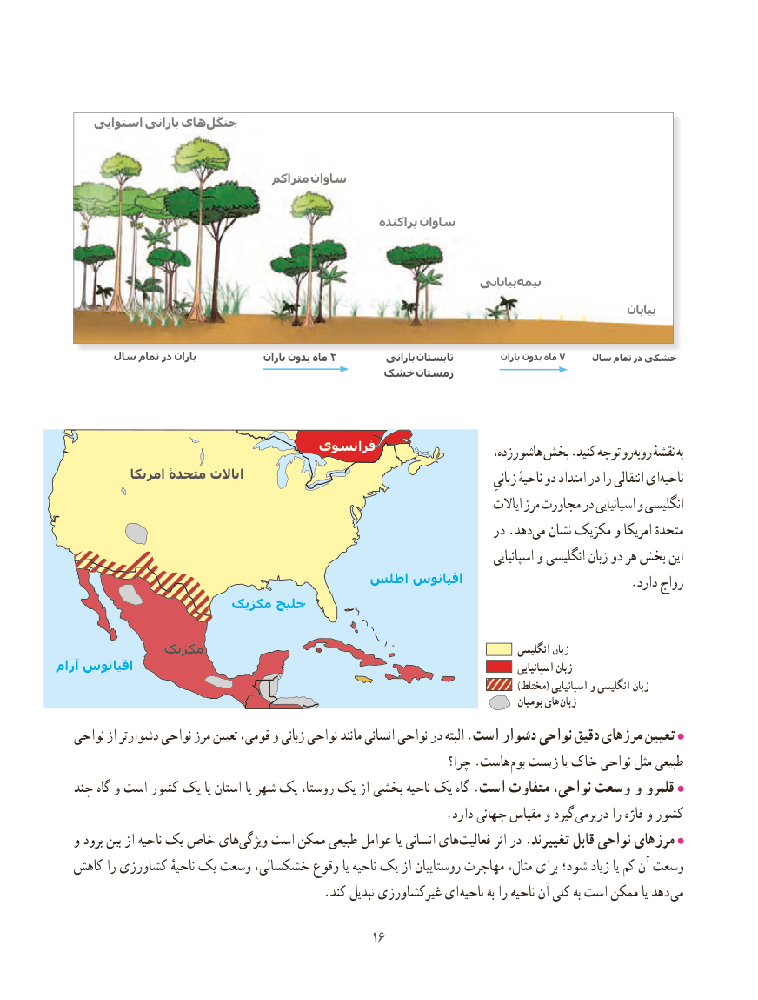

# PDF page 24

استوایی بارانی هایجنگل‌

                                   متراکم ساوان

                                                          پراکنده ساوان

                                                                               بیابانی نیمه

                                                                                                                    بیابان

        سال تمام در باران               باران بدون ماه 2          بارانی تابستان            باران بدون ماه 7    سال تمام در خشکی
                                خشک زمستان

                                فرانسوی                        ،زده هاشور بخش .کنید توجه روروبه‌    نقشهٔ به
             امریکا متحدۀ ایاالت                                                                 زبانیِ ناحیهٔ دو امتداد در را انتقالی ایناحیه‌
                                                                                           ایاالت مرز مجاورت در اسپانیایی و انگلیسی
                                                                          در .دهدمی‌  نشان مکزیک و امریکا متحدهٔ
                                                                                                 اسپانیایی و انگلیسی زبان دو هر بخش این
                                اطلس اقیانوس                            .دارد رواج
                      مکزیک خلیج

             مکزیک                                                                    انگلیسی زبان
آرام اقیانوس                                                                                                اسپانیایی زبان
                                                                                                                                                           )مختلط( اسپانیایی و انگلیسی زبان
                                                                                                               بومیان های زبان
   نواحی از دشوارتر نواحی مرز تعیین قومی، و زبانی نواحی مانند انسانی نواحی در البته .است دشوار نواحی دقیق مرزهای تعیین
                                                                     چرا؟ .هاست بوم زیست یا خاک‌    نواحی مثل طبیعی
   چند گاه و است کشور یک یا استان یا شهر یک روستا، یک از بخشی ناحیه یک گاه .است متفاوت ،نواحی وسعت و قلمرو
                                                                .دارد جهانی مقیاس و گیرد دربرمی را قارّه و کشور
   و برود بین از ناحیه یک خاص های ‌ویژگی است ممکن طبیعی عوامل یا انسانی های ‌فعالیت اثر در .تغییرند قابل نواحی مرزهای
  کاهش را کشاورزی ناحیهٔ یک وسعت خشکسالی، وقوع یا ناحیه یک از روستاییان مهاجرت مثال، برای شود؛ زیاد یا کم آن وسعت
    . کند تبدیل غیرکشاورزی ای ناحیه به را ناحیه آن کلی به است ممکن یا دهد می

                                                1616

