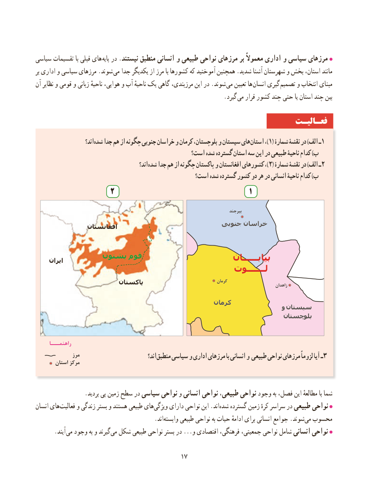

# PDF page 25

سیاسی تقسیمات با قبلی های پایه در .نیستند منطبق انسانی و طبیعی نواحی مرزهای بر ًمعموال اداری و سیاسی مرزهای
بر اداری و سیاسی مرزهای .شوند می جدا یکدیگر از مرز با کشورها که آموختید همچنین .شدید آشنا شهرستان و بخش استان، مانند
آن نظایر و قومی و زبانی ناحیهٔ هوایی، و آب ناحیهٔ یک گاهی مرزبندی، این در .شوند  می تعیین ها انسان گیری تصمیم و انتخاب مبنای
                          . گیرد می قرار کشور چند حتی یا استان چند بین

                                                                 فعـالیـت
                       اند؟شده‌   جدا هم از چگونه جنوبی خراسان و کرمان ،بلوچستان و سیستان هایاستان‌      ،)1( شمارۀ نقشۀ در )الف ـ1
                                              است؟ شده گسترده استان سه این در طبیعی ناحیۀ کدام )ب
                                                اند؟ شده جدا هم از چگونه پاکستان و افغانستان کشورهای ،)2( شمارۀ نقشۀ در )الف ـ2
                                               است؟ شده گسترده کشور دو هر در انسانی ناحیۀ کدام )ب
                  2                                          1

                                                                                              بیرجند

                                               جنوبی خراسان               افغانستان

              پشتون قوم                             بیابــــــان     ایران
                                                          لـــــــوت
                        پاکستان                                   کرمان                                                                                                                        زاهدان

                                                  کرمان
                                                                         و سیستان
                                                                     بلوچستان

      راهنمـــا
               مرز                               اند؟ منطبق سیاسی و اداری مرزهای با انسانی و طبیعی نواحی مرزهای ًلزوما آیا ـ3        استان مرکز

                 .بردید پی زمین سطح در سیاسی نواحی و انسانی نواحی طبیعی، نواحی وجود به فصل، این مطالعهٔ با شما
انسان های‌فعالیت و زندگی بستر و هستند طبیعی های ‌ویژگی دارای نواحی این .اند ‌شده گسترده زمین کرهٔ سراسر در طبیعی نواحی
                                        .اند‌وابسته طبیعی نواحی به حیات ادامهٔ برای انسانی جوامع .شوند ‌می محسوب
   . آیند می وجود به و گیرندمی‌  شکل طبیعی نواحی بستر در ...و اقتصادی فرهنگی، جمعیتی، نواحی شامل انسانی نواحی

                                           1717

