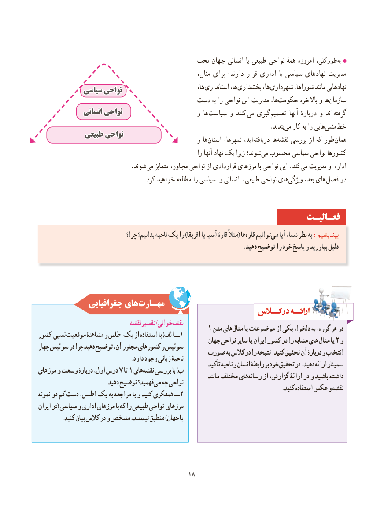

# PDF page 26

تحت جهان انسانی  یا طبیعی نواحی همهٔ امروزه کلی،  طور  به
       ،مدیریتمثال برای دارند؛ قرار اداری  یا سیاسی نهادهای
                                                                   ها، استانداری ها، بخشداری ها، شهرداری شوراها، مانند نهادهایی            سیاسیسیاسی نواحینواحی
                                     دست به را نواحی این مدیریت ها،‌حکومت باالخره و هاسازمان‌
              انسانیانسانی نواحینواحی                         و ها ‌سیاست و کنند  می گیری ‌تصمیم آنها دربارهٔ و اند  گرفته
                             .‌بندند می کار به را هاییمشی‌      ‌خط
             طبیعیطبیعی نواحینواحی                                                    و ها‌استان شهرها، اید،  دریافته ها ‌نقشه بررسی از که طور‌همان
                                                                را آنها نهاد یک زیرا شوند؛ ‌می محسوب سیاسی نواحی کشورها
           . شوند می متمایز مجاور، نواحی از قراردادی مرزهای با نواحی این .کند  می مدیریت و اداره
 .‌کرد خواهید مطالعه را سیاسی و انسانی طبیعی، نواحی هایویژگی بعد، هایفصل‌    در

                                                                فعـالیـت
                                 چرا؟ بدانیم؟ ناحیه یک را )افریقا یا آسیا قارۀ مثال( هاقاره‌   توانیممی‌   آیا ،شما نظر به :بیندیشیم
                                                                        .دهید توضیح را خود پاسخ و بیاورید دلیل

             جغرافیایی هایمهـارت‌
                                نقشهتفسیر/خوانینقشه‌                                          1 متن هایمثال‌     یا موضوعات از یکی دلخواه به ،گروه هر درکشور نسبی موقعیت مشاهدۀ و اطلس یک از استفاده با )الف ــ1                                                        جهان نواحی سایر یا ایران کشور در را مشابه های مثال یا 2 وچهار سوئیس در چرا دهید توضیح ،آن مجاور کشورهای و سوئیس                                       صورت به کالس در را نتیجه .کنید تحقیق آن دربارۀ و انتخاب                                .دارد وجود زبانی ناحیۀ                                                            کید تأ ناحیه و انسان رابطۀ بر خود تحقیق در .دهید ارائه سمینارمرزهای و وسعت دربارۀ ،اول درس 7 تا 1 هاینقشه‌   بررسی با )ب                                                                          مانند مختلف هایرسانه‌     از ،گزارش ارائۀ در و باشید داشته                        .دهید توضیح فهمید؟ می چه نواحی                                                                                     .کنید استفاده عکس و نقشهنمونه دو کم دست ،اطلس یک به مراجعه با و کنید همفکری ــ2
ایران در( سیاسی و اداری مرزهای با که را طبیعی نواحی مرزهای
        .کنید بیان کالس در و مشخص ،نیستند منطبق )جهان یا

                                          1818

