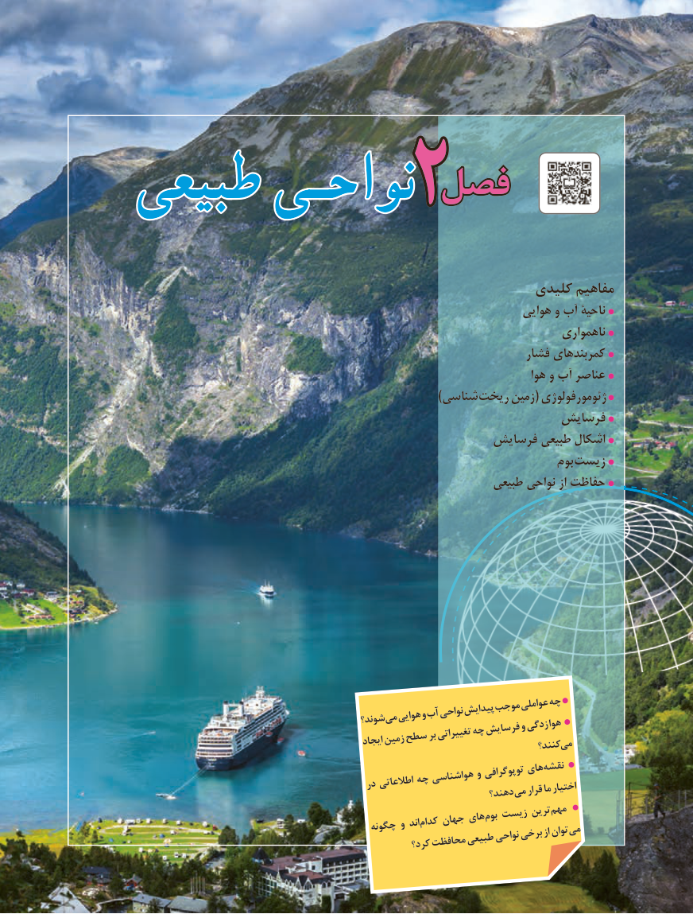

# PDF page 27

فصلفصلطبیعیطبیعی نواحـینواحـی      2

                                                     کلیدی مفاهیم
                                                                   هوایی و آب ناحیۀ
                                                                              ناهمواری
                                                                 فشار کمربندهای
                                                                               هوا و آب عناصر
                                                                         )شناسی ریخت زمین( ژئومورفولوژی
                                                         فرسایش
                                                فرسایش طبیعی اشکال
                                                                           بوم زیست
                                                           طبیعی نواحی از حفاظت

                                                          چه                                                    موجبعواملی                                                           نواحیپیدایش                                           وآب                                                       میهوایی                                          شوند؟                                                                                           هوا                                                           وزدگی                                               چهفرسایش                                                                 برتغییراتی                                  سطح                                                  ایجادزمین                                                           می                                                                                 کنند؟
                                                                های نقشه                                                    و توپوگرافی                                       چه هواشناسی                                        در اطالعاتی                                                                 دهند؟ میقرارمااختیار
                                                                                            مهم                                                                          ترین                                                     زیست                                                      های بوم                                                  جهان                                                               کدام                                          چگونه و اند                                                                                      توان می                                                                                                از                                                                برخی                                                                     نواحی                                                         طبیعی                                                 محافظت                                                    کرد؟

