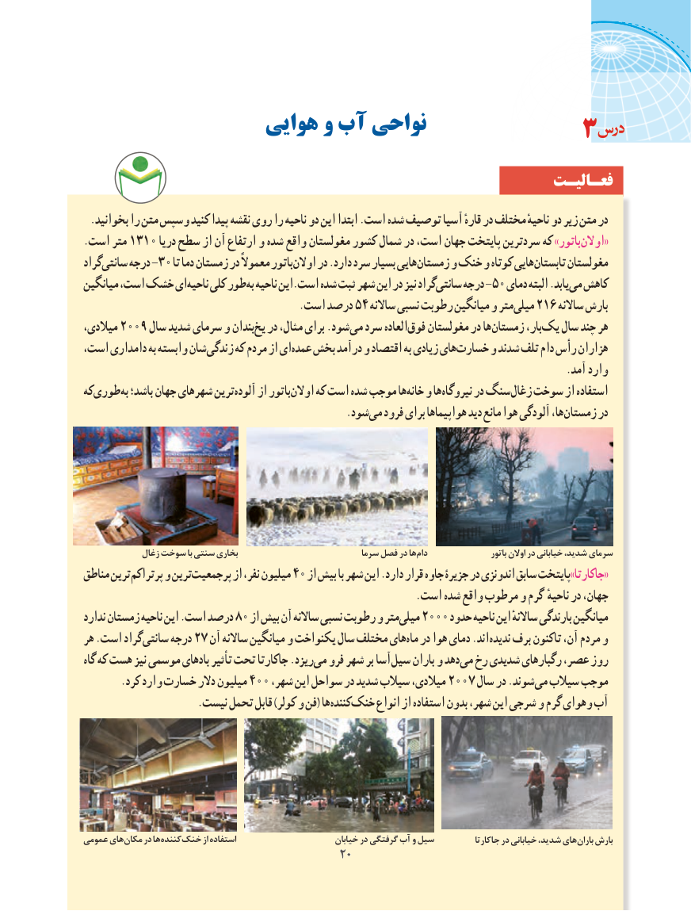

# PDF page 28

هوایی و آب نواحی                                3
                                                               فعـالیـت
 .بخوانید را متن وسپس کنید پیدا نقشه روی را ناحیه دو این ابتدا .است شده توصیف آسیا قارهٔ در مختلف ناحیهٔ دو زیر متن در
.است متر 1310 دریا سطح از آن ارتفاع و شده واقع مغولستان کشور شمال در است، جهان پایتخت سردترین که »باتوراوالن‌«
گرادسانتی‌    درجه -30 تا دما زمستان در معموالً باتوراوالن‌    در .دارد سرد بسیار هاییزمستان‌     و خنک و کوتاه هاییتابستان‌      مغولستان
میانگین است، خشک ای ناحیه کلی طور به ناحیه این.است شده ثبت شهر این در نیز گرادسانتی‌    درجه -50 دمای البته .یابد می کاهش
         .54است درصد    ساالنه نسبی رطوبت میانگین و متر میلی 216 ساالنه بارش
میالدی، 2009 سال شدید سرمای و بندان یخ در مثال، برای .شود می سرد العاده فوق مغولستان در هازمستان‌        بار،یک‌   سال چند هر
است، دامداری به وابسته شانزندگی‌     که مردم از ایعمده‌  بخش درآمد و اقتصاد به زیادی های خسارت و شدند تلف دام رأس هزاران
                                                                                              .آمد وارد
کهطوری‌      به‌ باشد؛ جهان شهرهای ترینآلوده‌    از باتوراوالن‌    که است شده موجب هاخانه‌  و هانیروگاه‌     در سنگزغال‌   سوخت از استفاده
                                                   .شودمی‌  فرود برای هواپیماها دید مانع هوا آلودگی ها،زمستان‌      در

             زغال سوخت با سنتی بخاری                            سرما فصل در ها دام                    باتور اوالن در خیابانی شدید، سرمای
مناطق ترینپرتراکم‌     و ترینپرجمعیت‌        از نفر، میلیون 40 از بیش با شهر این .دارد قرار جاوه جزیرۀ در اندونزی سابق پایتخت»جاکارتا«
                                                                 .است شده واقع مرطوب و گرم ناحیهٔ در جهان،
ندارد زمستان ناحیه این .است درصد 80 از بیش آن ساالنه نسبی رطوبت و مترمیلی‌   2000 حدود ناحیه این ساالنهٔ بارندگی میانگین
هر .است گراد سانتی درجه 27 آن ساالنه میانگین و یکنواخت سال مختلف هایماه‌  در هوا دمای .اند ندیده برف تاکنون آن، مردم و
گاه که هست نیز موسمی بادهای تأثیر تحت جاکارتا .ریزدمی‌  فرو شهر بر آسا سیل باران و دهد می رخ شدیدی رگبارهای عصر، روز
 .‌کرد وارد خسارت دالر میلیون 400 ،شهر این سواحل در شدید سیالب میالدی، 2007 سال در .شوندمی‌  سیالب موجب
  .‌نیست تحمل قابل )کولر و فن( هاکنندهخنک‌     انواع از استفاده بدون شهر، این شرجی و گرم وهوای آب‌

عمومی های مکان در ها کننده خنک از استفاده                         خیابان در گرفتگی آب و سیل           جاکارتا در خیابانی شدید، های باران بارش
                                           2020

