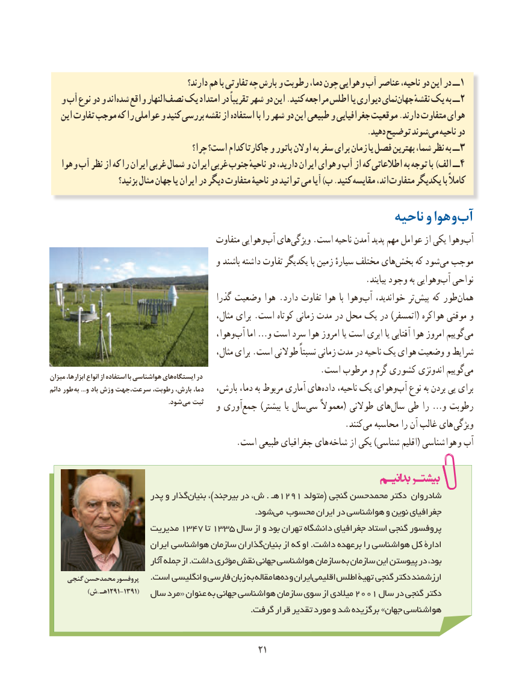

# PDF page 29

دارند؟ هم با تفاوتی چه بارش و رطوبت دما، چون وهوایی آب‌  عناصر ناحیه، دو این در ــ 1
  و آب نوع دو و اندشده‌   واقع النهارنصف‌   یک امتداد در تقریباً شهر دو این .کنید مراجعه اطلس یا دیواری نمایجهان‌     نقشهٔ یک به ــ2
   این تفاوت موجب که را عواملی و کنید بررسی نقشه از استفاده با را شهر دو این طبیعی و جغرافیایی موقعیت .دارند متفاوت هوای
          .‌دهید توضیح شوندمی ناحیه دو
                                       چرا؟ است؟ کدام جاکارتا و باتور اوالن به سفر برای زمان یا فصل بهترین شما، نظر به ــ 3
   هوا و آب نظر از که را ایران غربی شمال و ایران غربی جنوب ناحیهٔ دو دارید، ایران وهوای آب از که اطالعاتی به توجه با )الف ــ4
                      بزنید؟ مثال جهان یا ایران در دیگر متفاوت ناحیۀ دو توانید می آیا )ب .کنید مقایسه اند، متفاوت یکدیگر با کامالً
                                                          ناحیه و هوا ‌و ‌آب
                                          متفاوت وهوایی ‌آب های‌ویژگی .است ناحیه آمدن پدید مهم عوامل از یکی وهوا‌آب
                                        و باشند داشته تفاوت یکدیگر با زمین سیارهٔ مختلف هایبخش‌     که شودمی‌  موجب
        .‌بیایند وجود به وهوایی آب نواحی
                                           گذرا وضعیت هوا . دارد تفاوت هوا  با وهوا‌آب خواندید، تر پیش که طور‌همان
                                                 مثال، برای .است کوتاه زمانی مدت در محل یک در )اتمسفر( هواکره موقتی و
                                            وهوا،‌آب اما …و است سرد هوا امروز یا است ابری یا آفتابی هوا امروز گوییم ‌می
                                                 مثال، برای .است طوالنی نسبتاً زمانی مدت در ناحیه یک هوای وضعیت و شرایط
                                                                .است مرطوب و گرم کشوری اندونزی گوییممی‌میزان ابزارها، انواع از استفاده با هواشناسی هایایستگاه‌      در
دائم طور  به ...و باد وزش سرعت،جهت رطوبت، بارش، دما،   بارش، دما، به مربوط آماری های ‌داده ناحیه، یک وهوای ‌آب نوع به بردن پی برای
               .‌شودمی ثبت   و آوری ‌جمع ) بیشتر یا سال ‌سی معموالً ( طوالنی های ‌سال طی را … و رطوبت
                             .‌کنند می محاسبه را آن غالب های ویژگی
    . است طبیعی جغرافیای های شاخه از یکی )شناسی اقلیم( شناسی هوا و آب

                       پدر و گذاربنیان‌       ،)بیرجند در ش، . هـ1291  متولد( گنجی محمدحسن دکتر شادروان
                                                                           .شود می محسوب ایران در هواشناسی و نوین جغرافیای
                     مدیریت 1347 تا 1335 سال از و بود تهران دانشگاه جغرافیای استاد گنجی پروفسور
                          ایران هواشناسی سازمان گذارانبنیان‌     از که او .داشت برعهده را هواشناسی کل ادارۀ
                                 آثار جمله از .داشت مؤثری نقش جهانی هواشناسی سازمان به سازمان این پیوستن در بود،
    گنجی محمدحسن پروفسور    .است انگلیسی و فارسی زبان به مقاله هاده‌ و ایراناقلیمی     اطلس تهیۀ گنجی دکتر ارزشمند
     ) ش. هـ 1291-1391(  سال مرد « عنوان به جهانی هواشناسی سازمان سوی از میالدی 2001 سال در گنجی دکتر
                                                                          .گرفت قرار تقدیر مورد و شد برگزیده »جهان هواشناسی

                                              2121

