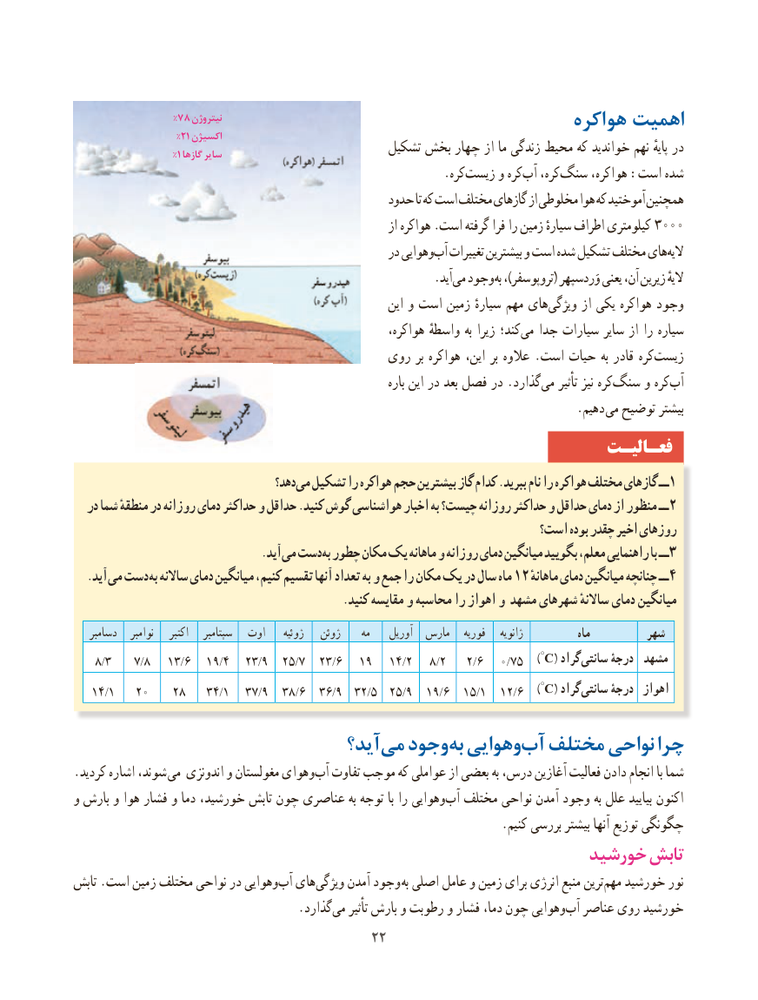

# PDF page 30

٪۷۸ نیتروژن                                                        هواکره اهمیت                       ٪۲۱ اکسیژن
                        ٪۱ گازها سایر                         تشکیل بخش چهار از ما زندگی محیط که خواندید نهم پایهٔ در
                              .‌کره زیست و کرهآب‌   کره،‌سنگ هواکره، :است شده
                                                حدود تا که است مختلف گازهای از مخلوطی هوا که آموختید همچنین
                                                                   از هواکره .است گرفته فرا را زمین سیارهٔ اطراف کیلومتری 3000
                                                      در وهواییآب‌  تغییرات بیشترین و است شده تشکیل مختلف هایالیه‌
                                  . آیدمی وجود به ،)تروپوسفر( وَردسپهر یعنی آن، زیرین الیهٔ
                                                              این و است زمین سیارهٔ مهم هایویژگی‌      از یکی هواکره وجود
                                                            هواکره، واسطهٔ به زیرا کند؛‌می جدا سیارات سایر از را سیاره
                                         روی بر هواکره این، بر عالوه . است حیات به قادر کره‌زیست
                                                                            باره این در بعد فصل در .گذارد‌می تأثیر نیز کره ‌سنگ و کره‌آب
                                . دهیم می توضیح بیشتر
                                                                 فعـالیـت
                                      دهد؟می‌  تشکیل را هواکره حجم بیشترین گاز کدام .ببرید نام را هواکره مختلف گازهای ــ1
  در شما منطقهٔ در روزانه دمای حداکثر و حداقل .کنید گوش هواشناسی اخبار به چیست؟ روزانه حداکثر و حداقل دمای از منظور ــ 2
                                                                   است؟ بوده چقدر اخیر روزهای
                . آیدمی دست به چطور مکان یک ماهانه و روزانه دمای میانگین بگویید معلم، راهنمایی با ــ3
  .آید می دست به ساالنه دمای میانگین کنیم، تقسیم آنها تعداد به و جمع را مکان یک در سال ماه 12 ماهانهٔــدمای میانگین چنانچه 4
                                                .کنید مقایسه و محاسبه را اهواز و مشهد شهرهای ساالنهٔ دمای میانگین
   دسامبر   نوامبر    اکتبر   سپتامبر   اوت    ژوئیه   ژوئن     مه    آوریل  مارس   فوریه    ژانویه            ماه         شهر
    8/3    7/8   13/6   19/4   23/9  25/7  23/6   19   14/2   8/2    2/6   0/75   )°C ( گراد سانتی درجۀ  مشهد
   14/1   20    28    34/1   37/9  38/6  36/9  32/5  25/9  19/6  15/1  12/6   )°C ( گراد سانتی درجۀ  اهواز
                                آید؟می‌  وجود به وهواییآب‌  مختلف نواحی چرا
.کردید اشاره شوند، می اندونزی و مغولستان وهوای ‌آب تفاوت موجب که عواملی از بعضی به درس، آغازین فعالیت دادن انجام با شما
و بارش و هوا فشار و دما خورشید، تابش چون عناصری به توجه با را وهوایی‌آب مختلف نواحی آمدن وجود به علل بیایید اکنون
                                                                      .کنیم بررسی بیشتر آنها توزیع چگونگی
                                                     خورشید تابش
تابش .است زمین مختلف نواحی در وهوایی‌آب های‌ویژگی آمدن وجود به اصلی عامل و زمین برای انرژی منبع ترین‌مهم خورشید نور
                                     .گذارد ‌می تأثیر بارش و رطوبت و فشار دما، چون وهواییآب‌  عناصر روی خورشید
                                       2222

