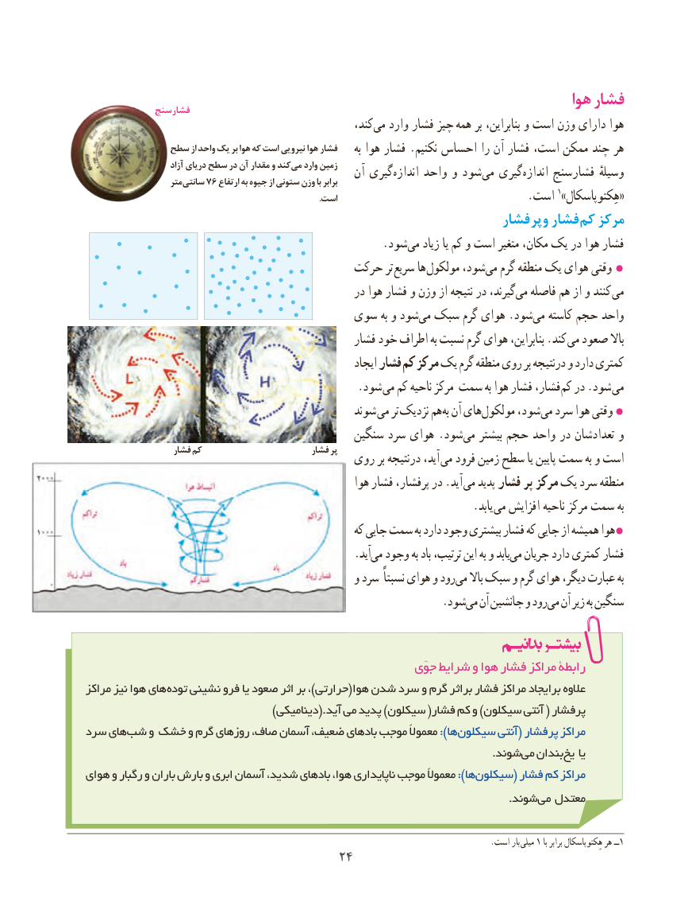

# PDF page 32

هوا فشار              فشارسنج
                                                        کند،می‌   وارد فشار چیز‌ همه بر بنابراین، و است وزن دارای هوا
             سطح از واحد یک بر هوا که است نیرویی هوا فشار                                                                              به هوا فشار .نکنیم احساس را آن فشار است، ممکن چند هر
                         آزاد دریای سطح در آن مقدار و کند می وارد زمین   آن گیری‌اندازه واحد و شود‌می گیری‌اندازه فشارسنج وسیلهٔ                     متر سانتی 76 ارتفاع به جیوه از ستونی وزن با برابر
                                                                                                                   ١                                                                                                            .است                                  .است »«هِکتوپاسکال
                                                            فشار وپر فشار کم مرکز
                                                      .شود‌می زیاد یا کم و است متغیر مکان، یک در هوا فشار
                                     حرکت تر سریع ها مولکول شود،می‌  گرم منطقه یک هوای وقتی 
                                                  در هوا فشار و وزن از نتیجه در گیرند،می‌  فاصله هم از و کنند می
                                   سوی به و شودمی‌ سبک گرم هوای .شودمی‌   کاسته حجم واحد
                                                  فشار خود اطراف به نسبت گرم هوای بنابراین، .کند می صعود باال
                                                           ایجاد فشار کم مرکز یک گرم منطقه روی بر درنتیجه و دارد کمتری
                    . شود می کم ناحیه مرکز سمت به هوا فشار فشار، کم در .شود می
                                                شوند می تر نزدیک همبه‌ آن هایمولکول‌      شود،می‌  سرد هوا وقتی 
                                             سنگین سرد هوای .شودمی‌   بیشتر حجم واحد در تعدادشان و
                    فشار کم                         فشار پر                                       روی بر درنتیجه آید، می فرود زمین سطح یا پایین سمت به و است
                                                      هوا فشار پرفشار، در .آید  می پدید فشار پر مرکز یک سرد منطقه
                                  . یابد می افزایش ناحیه مرکز سمت به
                                                       که جایی سمت به دارد وجود بیشتری فشار که جایی از همیشه هوا
                                                .آیدمی‌  وجود به باد ترتیب، این به و یابدمی‌  جریان دارد کمتری فشار
                                                 و سرد نسبتاً هوای و رودمی‌   باال سبک و گرم هوای دیگر، عبارت به
                           .‌شودمی آن جانشین و رودمی‌  آن زیر به سنگین

                                                            جوّی شرایط و هوا فشار مراکز رابطۀ
مراکز نیز هوا های توده نشینی فرو یا صعود اثر بر ،)حرارتی(هوا شدن سرد و گرم براثر فشار مراکز برایجاد عالوه
                                        )دینامیکی.(آید می پدید )سیکلون (فشار کم و )سیکلون آنتی ( پرفشار
سرد هایشب‌   و خشک و گرم روزهای صاف، آسمان ضعیف، بادهای موجب معموالً ):ها سیکلون ‌آنتی( پرفشار مراکز
                         .‌شوندمی بندان یخ یا
هوای و رگبار و باران بارش و ابری آسمان شدید، بادهای هوا، ناپایداری موجب معموالً ):هاسیکلون‌        ( فشار کم مراکز
                                                                                                                     .شوند می معتدل

                                                                                                      .است بار  میلی١ با١برابر هِکتوپاسکال هر ــ
                                    2424

