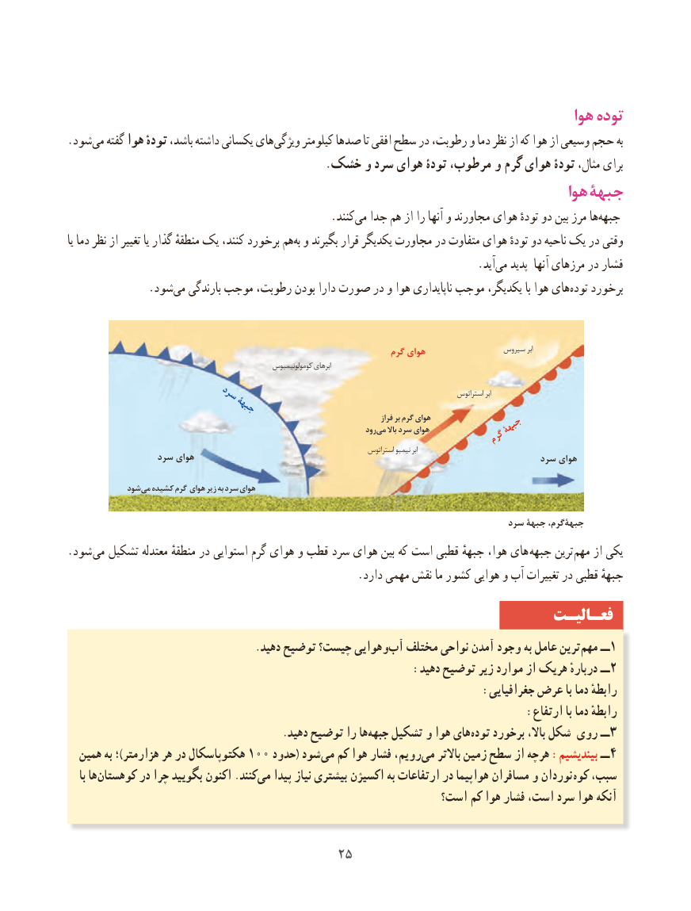

# PDF page 33

هوا توده
.شود‌می گفته هوا تودهٔ باشد، داشته یکسانی های ‌ویژگی کیلومتر صدها تا افقی سطح در رطوبت، و دما نظر از که هوا از وسیعی حجم به
                                               .خشک و سرد هوای تودۀ مرطوب، و گرم هوای تودۀ مثال، برای
                                                                            هوا جبهۀ
                    .‌کنند می جدا هم از را آنها و مجاورند هوای تودهٔ دو بین مرز هاجبهه‌
یا دما نظر از تغییر یا گذار منطقهٔ یک کنند، برخورد هم‌به و بگیرند قرار یکدیگر مجاورت در متفاوت هوای تودهٔ دو ناحیه یک در وقتی
                                        .‌آید می پدید  آنها مرزهای در فشار
      .‌شودمی بارندگی موجب رطوبت، بودن دارا صورت در و هوا ناپایداری موجب یکدیگر، با هوا هایتوده‌   برخورد

                                                                     گرم هوای                  سیروس ابر
                                                            کومولونیمبوس ابرهای

                                                                                                                    استراتوس ابر                   سرد                         جبهۀ                                                                                                       فراز بر گرم هوای                                                                                  رود می باال سرد هوای          جبهۀ                                                        گرم
                                                                                          استراتوس نیمبو ابر
                 سرد هوای                                                                 سرد هوای

             شود می کشیده گرم هوای زیر به سرد هوای

                                                                                   سرد جبهۀ جبهۀگرم،
.شود می تشکیل معتدله منطقهٔ در استوایی گرم هوای و قطب سرد هوای بین که است قطبی جبههٔ هوا، های جبهه ترین مهم از یکی
                                                    .دارد مهمی نقش ما کشور هوایی و آب تغییرات در قطبی جبههٔ
                                                                 فعـالیـت
                                    .دهید توضیح چیست؟ وهوایی‌آب مختلف نواحی آمدن وجود به عامل ترین‌مهم ــ1
                                                     :دهید توضیح زیر موارد از هریک دربارهٔ ــ2
                                                                :جغرافیایی عرض با دما رابطهٔ
                                                                       :ارتفاع با دما رابطهٔ
     .‌دهید توضیح را ها جبهه تشکیل و هوا هایتوده‌    برخورد باال، شکل روی ــ3
  همین به ؛)هزارمتر هر در هکتوپاسکال 100 حدود( شود ‌می کم هوا فشار رویم،‌می باالتر زمین سطح از هرچه :بیندیشیم ــ 4
    با ها‌کوهستان در چرا بگویید اکنون .کنندمی‌   پیدا نیاز بیشتری اکسیژن به ارتفاعات در هواپیما مسافران و نوردان  کوه سبب،
                                                         است؟ کم هوا فشار است، سرد هوا آنکه

                                     2525

