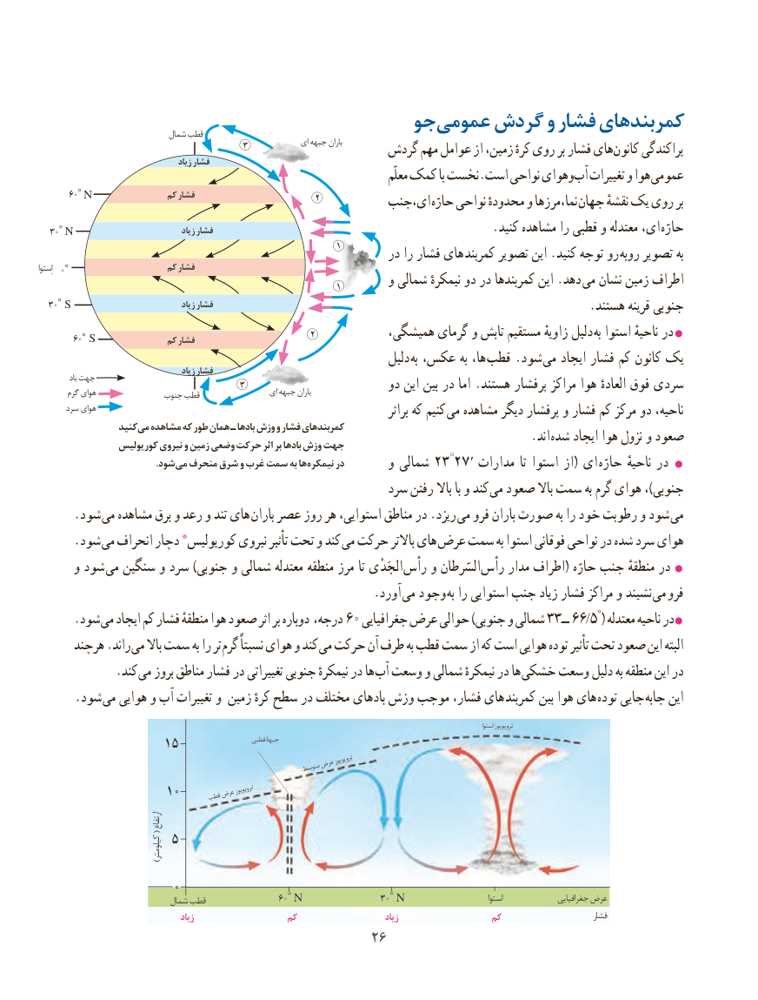

# PDF page 34

شمال قطب                  جو عمومی گردش و فشار کمربندهای
                                         3             ای جبهه باران      گردش مهم عوامل از زمین، کرهٔ روی بر فشار هایکانون‌     پراکندگی                                         زیاد فشار
                                                                                        معلّم کمک با نخست.است نواحی وهوایآب‌  تغییرات و هوا عمومی
     60◦N               کم فشار                        2          ای،جنب حارّه نواحی محدودهٔ و نما،مرزها جهان نقشهٔ یک روی بر
  30◦N                                زیاد فشار   . کنید مشاهده را قطبی و معتدله ای، حارّه
                                                            1        در را فشار های  کمربند تصویر این .کنید توجه رو روبه تصویر به
اِستوا  0◦                    کم فشار                                                            1        و شمالی نیمکرهٔ دو در کمربندها این .دهد  می نشان زمین اطراف
  30◦S                                زیاد فشار                                                              .هستند قرینه جنوبی
                                                                     60◦S              کم فشار                       2           همیشگی، گرمای و تابش مستقیم زاویهٔ دلیل به استوا ناحیهٔ در
                                                                 دلیل به عکس، به ها، قطب .شود می ایجاد فشار کم کانون یک                                          زیاد فشار            باد جهت                                         3                                                           دو این بین در اما .هستند پرفشار مراکز هوا العادهٔ فوق سردی       گرم هوای              جنوب قطب                 ای جبهه باران
      سرد هوای                                                                                       براثر که کنیم می مشاهده دیگر پرفشار و فشار کم مرکز دو ناحیه،
                 کنید می مشاهده که طور همان ـ بادها وزش و فشار کمربندهای
                کوریولیس نیروی و زمین وضعی حرکت اثر بر بادها وزش جهت                 . اند شده ایجاد هوا نزول و صعود
                                                                                                                                          ′           . شودمی منحرف شرق و غرب سمت به ها نیمکره در                                                                         مدارات  تا استوا از ( ای   حارّه ناحیهٔ در                                                            و شمالی ٢٣ ° ٢٧
                                                      سرد رفتن باال با و کند می صعود باال سمت به گرم هوای ،)جنوبی
      .شود  می مشاهده برق و رعد و تند های  باران عصر روز هر استوایی، مناطق در .ریزد می فرو باران صورت به را خود رطوبت و شود می
      .شود *می انحراف دچار    کوریولیس نیروی تأثیر تحت و کند می حرکت باالتر های عرض سمت به استوا فوقانی نواحی در شده سرد هوای
      و شود  می سنگین و سرد )جنوبی و شمالی معتدله منطقه مرز تا ْی الجَد رأس و السّرطان رأس مدار اطراف( حارّه جنب منطقهٔ در 
                                                       .آورد  می وجود  به را استوایی جنب زیاد فشار مراکز و نشیند می  فرو
      .شود می ایجاد کم فشار منطقهٔ هوا صعود اثر بر دوباره درجه، 60 جغرافیایی عرض حوالی )جنوبی و شمالی 33ــ 66/5°( معتدله ناحیه در
      هرچند .راند می باال سمت به را تر گرم نسبتاً هوای و کند می حرکت آن طرف به قطب سمت از که است هوایی توده تأثیر تحت صعود این البته
             .کند می بروز مناطق فشار در تغییراتی جنوبی نیمکرهٔ در ها آب وسعت و شمالی نیمکرهٔ در ها خشکی وسعت دلیل به منطقه این در
      .شود  می هوایی و آب تغییرات و زمین کرهٔ سطح در مختلف بادهای وزش موجب فشار، های کمربند بین هوا های توده جایی جابه این

                                                                                                                                                                                                استوا تروپوپوز
                  15                     قطبی جبهۀ
                                                      عرضتروپوپوز                                                                  متوسط
                  10     قطبعرضتروپوپوز
                                          ارتفاع
       (
                   5                                                 کیلومتر)
                   0                             شمال قطب            60◦N             30◦N                           استوا               جغرافیایی عرض
                                         زیاد                  کم                         زیاد                  کم                          فشار
                                            2626

