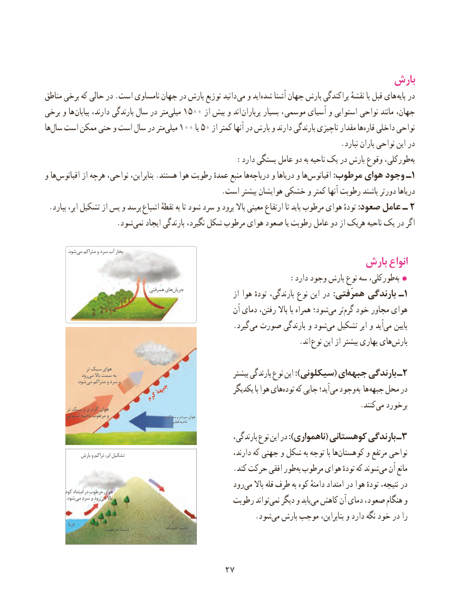

# PDF page 35

بارش
مناطق برخی که حالی در .است نامساوی جهان در بارش توزیع دانید می و اید‌شده آشنا جهان بارش پراکندگی نقشهٔ با قبل های پایه در
برخی و ها بیابان دارند، بارندگی سال در متر‌میلی 1500 از بیش و اند پرباران بسیار ،  موسمی آسیای و استوایی نواحی مانند جهان،
ها‌سال است ممکن حتی و است سال در مترمیلی١٠٠‌              یا 50 از کمتر آنها در بارش و دارند بارندگی ناچیزی مقدار ها‌قاره داخلی نواحی
                                                                                .نبارد باران نواحی این در
  :‌دارد بستگی عامل دو به ناحیه یک در بارش وقوع طورکلی،به
و ها‌اقیانوس از هرچه نواحی، بنابراین، .هستند هوا رطوبت عمدهٔ منبع ها‌دریاچه و دریاها و ها‌اقیانوس :مرطوب هوای وجود ـ 1
                                                .است بیشتر هوایشان خشکی و کمتر آنها رطوبت باشند دورتر دریاها
.2ببارد ابر، تشکیل از پس و برسد اشباع نقطهٔ به تا شود سرد و برود باال معینی ارتفاع تا باید مرطوب هوای تودهٔ :صعود عامل ـ
                   .شود ‌نمی ایجاد بارندگی نگیرد، شکل مرطوب هوای صعود یا رطوبت عامل دو از هریک ناحیه یک در اگر

     . شودمی متراکم و سرد آب بخار                                            بارش انواع
     :‌دارد وجود بارش نوع سه طورکلی،به 
                                          همرفتی های جریان                 از هوا تودهٔ بارندگی، نوع این در :همرَفتی بارندگی ـ1
                                                        آن دمای رفتن، باال با همراه شود؛‌می تر‌گرم خود مجاور هوای
                                                   .گیردمی‌  صورت بارندگی و شود‌می تشکیل ابر و آید‌می پایین
                                      . اند نوع این از بیشتر بهاری هایبارش‌

                      تر سبک هوای                  رود می باال سمت به                                      بیشتر بارندگی نوع این ):سیکلونی( ایجبهه‌     بارندگی ـ2      . شودمی متراکم و سرد و
                        جبهۀ                   یکدیگر با هوا هایتوده‌   که جایی آید؛ می وجود به ها جبهه محل در                    گرم
            تر سبک و تر گرم هوای                            .‌کنند می برخورد
          استوایی ناحیه مرطوب و                                       تر متراکم و سردتر هوای
                                                              قطبی ناحیه
                                                              بارندگی، نوع این در ):ناهمواری( کوهستانی بارندگی ـ3
               بارش و تراکم ابر، تشکیل   ،هادارند که جهتی و شکل به توجه با  کوهستان‌       و مرتفع نواحی
                                                   .کند حرکت افقی طور‌به مرطوب هوای تودهٔ که شوند‌می آن مانع
                                                    رود‌می باال قله طرف به کوه دامنهٔ امتداد در هوا تودهٔ نتیجه، در          کوه امتداد در مرطوب هوای
    . شودمی سرد و رود می باال                                             رطوبت تواند ‌نمی دیگر و یابد‌می کاهش آن دمای صعود، هنگام و
                       .‌شودمی بارش موجب بنابراین، و دارد نگه خود در را              دریا
                      مرطوب دامنۀ         خشک دامنۀ

                                     2727

