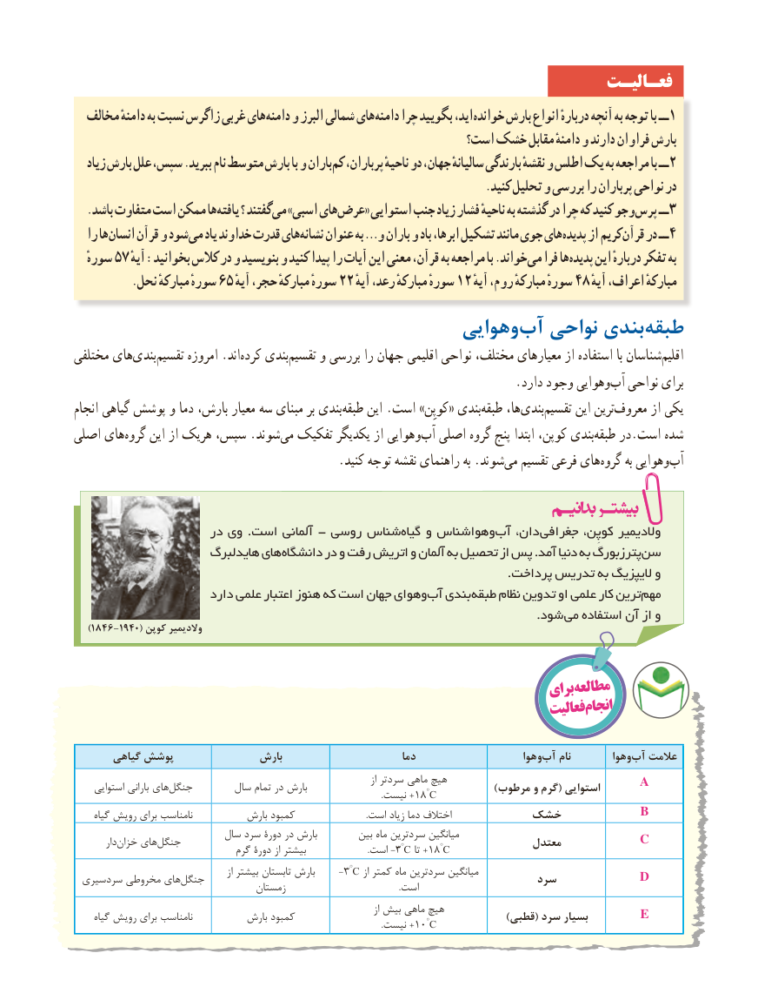

# PDF page 36

فعـالیـت
  مخالف دامنهٔ به نسبت زاگرس غربی های دامنه و البرز شمالی های دامنه چرا بگویید اید، خوانده بارش انواع دربارهٔ آنچه به توجه با ــ 1
                                                        است؟ خشک مقابل دامنهٔ و دارند فراوان بارش
   زیاد بارش علل سپس، .ببرید نام متوسط بارش با و بارانکم‌  پرباران، ناحیهٔ دو جهان، سالیانهٔ بارندگی نقشهٔ و اطلس یک به مراجعه با ــ2
                                                                         .کنید تحلیل و بررسی را پرباران نواحی در
. باشد متفاوت است ممکن هایافته ؟ گفتند می »اسبی های عرض« استوایی جنب زیاد فشار ناحیهٔ به گذشته در چرا که کنید وجو پرس ــ3
  را ها انسان قرآن و شود می یاد خداوند قدرت های نشانه عنوان به …و باران و باد ابرها، تشکیل مانند جوی های پدیده از کریم قرآن در ــ 4
  سوره 57 آیهٔخواند:بخوانید کالس در و بنویسید و کنید پیدا را آیات این معنی قرآن، به مراجعه با .          می فرا ها پدیده این دربارهٔ تفکر به
  .65نحل مبارکهٔ سورهٔ    آیهسورهٔحجر، مبارکهٔ    22 آیهسورهٔرعد، مبارکهٔ    12 آیهسورهٔروم، مبارکهٔ    48 آیهٔمبارکهٔاعراف،
                                         وهوایی‌آب نواحی بندی‌طبقه
مختلفی های‌بندی‌تقسیم امروزه .اند‌کرده بندی ‌تقسیم و بررسی را جهان اقلیمی نواحی مختلف، معیارهای از استفاده با شناساناقلیم‌
         .‌دارد وجود وهواییآب نواحی برای
انجام گیاهی پوشش و دما بارش، معیار سه مبنای بر بندی‌طبقه این .است »کوپِن« بندی ‌طبقه ها،‌بندی‌تقسیم این ترینمعروف‌       از یکی
اصلی های‌گروه این از هریک سپس، .شوند‌می تفکیک یکدیگر از وهوایی‌آب اصلی گروه پنج ابتدا کوپن، بندی ‌طبقه در.است شده
   .‌کنید توجه نقشه راهنمای به .شوندمی تقسیم فرعی هایگروه‌      به وهوایی‌آب

                     در وی .است آلمانی - روسی شناسگیاه‌   و وهواشناسآب‌   دان، جغرافی کوپِن، والدیمیر
                      هایدلبرگ هایدانشگاه‌      در و رفت اتریش و آلمان به تحصیل از پس .آمد دنیا به پترزبورگسن‌
                                                                                                              .پرداخت تدریس به الیپزیگ و
                       دارد علمی اعتبار هنوز که است جهان وهوایآب‌  بندی طبقه نظام تدوین او علمی کار ترینمهم‌
                               . شود می استفاده آن از و
   )1846-1940( کوپن والدیمیر

                                                                       برایمطالعه
                                                                           فعالیتانجام

       گیاهی پوشش               بارش                          دما                      وهوا‌آب نام         وهوا ‌آب عالمت
                                                                                                  از سردتر ماهی هیچ                    A     استوایی بارانی هایجنگل‌           سال تمام در بارش                                            )مرطوب و گرم( استوایی                                 .+18°Cنیست
     گیاه رویش برای نامناسب          بارش کمبود                                 .است زیاد دما اختالف        خشک         B
                           سال سرد دورۀ در بارش         بین ماه سردترین میانگین                   C         دار‌خزان های‌جنگل                                                             معتدل                                گرم دورۀ از بیشتر                             .است -3°C تا +18°C
                                                   از بیشتر تابستان بارش     -3°C از کمتر ماه سردترین میانگین                 D سردسیری مخروطی های‌جنگل                                                   سرد                                    زمستان                                                     .است
                                                                                                   از بیش ماهی هیچ                       E     گیاه رویش برای نامناسب          بارش کمبود                                                 )قطبی( سرد بسیار                                 .+10°Cنیست

