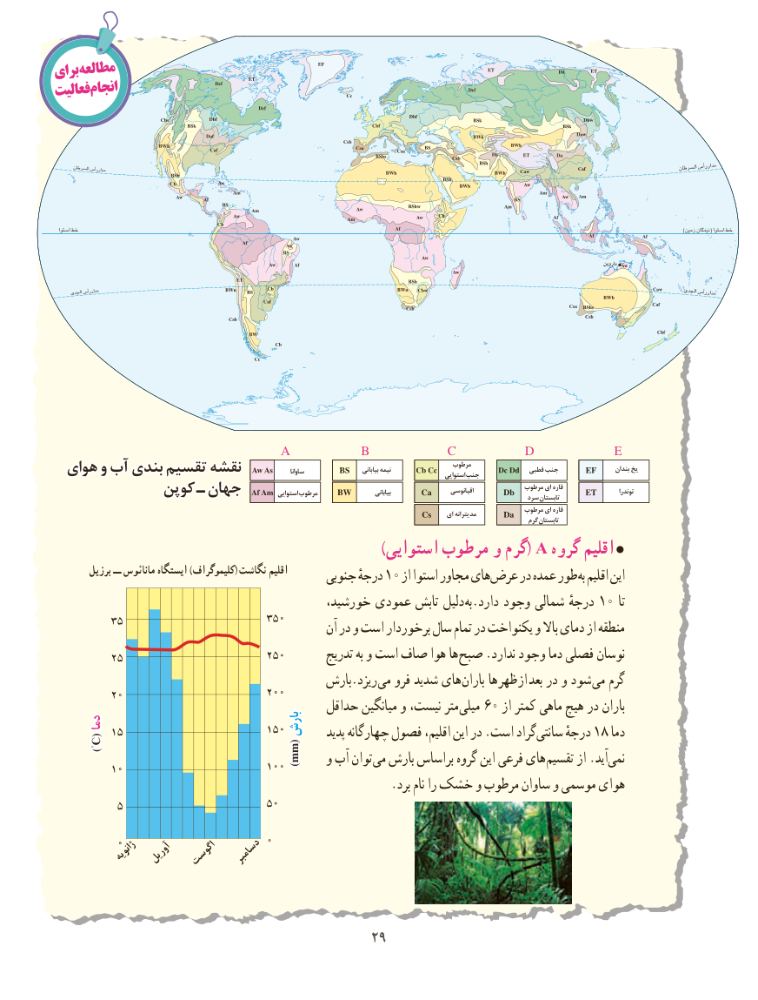

# PDF page 37

برایمطالعه
فعالیتانجام

                        A        B         C       D          E
                                                                                                          مرطوب
                                                                                                     ساوانا                        بیابانی نیمه                  استوایی جنب             قطبی جنب                   بندان یخ  هوایهوای وو آبآب بندیبندی تقسیمتقسیم نقشهنقشه
                                                                                                                                                   ای قاره                      توندرا                                                                                                                                         بیابانی                    اقیانوسی             مرطوب              کوپنکوپن ــ جهانجهان            استوایی مرطوب                                                                                                                            سرد تابستان
                                                                                                                           مرطوب ای قاره                                                                                                                     ای مدیترانه                                                                                                                                              گرم تابستان
                                                                     )استوایی مرطوب و گرم( A گروه اقلیم 
        برزیل ــ مانائوس ایستگاه )کلیموگراف( نگاشت اقلیم      جنوبی درجهٔ 10 از استوا مجاور هایعرض‌    در عمده طور به اقلیم این
                                           خورشید، عمودی تابش دلیل به.دارد وجود شمالی درجهٔ 10 تا
                                                  آن در و است برخوردار سال تمام در یکنواخت و باال دمای از منطقه
                                                   تدریج به و است صاف هوا ها صبح .ندارد وجود دما فصلی نوسان
                                           بارش.ریزد می فرو شدید های باران ها ظهر از بعد در و شود می گرم
                                          حداقل میانگین و نیست، متر میلی 60 از کمتر ماهی هیچ در باران
    دمادما                            بارشبارش                                                          پدید چهارگانه فصول اقلیم، این در .است گرادسانتی‌     درجهٔ 18 دما         )°C(
                                           mm()mm    و آب توان می بارش براساس گروه این فرعی های تقسیم از .آیدنمی‌
                                                        .برد نام را خشک و مرطوب ساوان و موسمی هوای

           ژانویه آوریل اگوست  دسامبر

                                          2929

