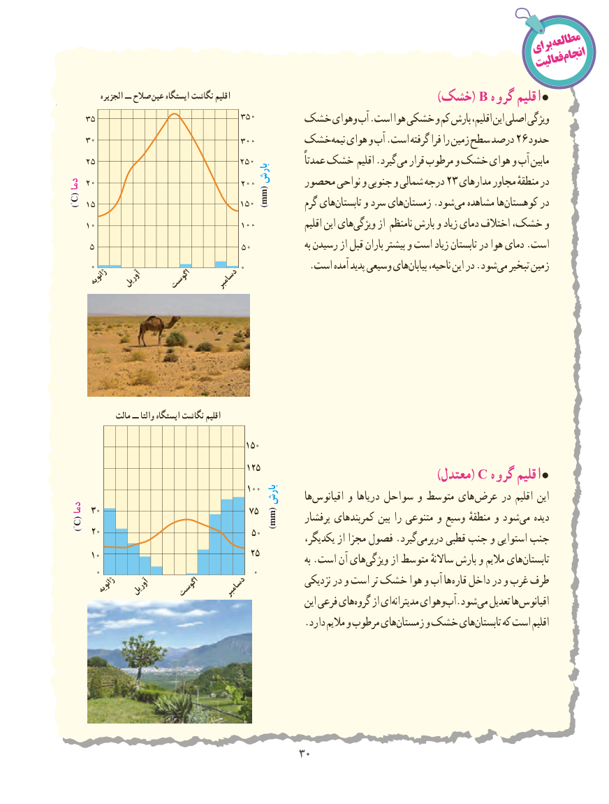

# PDF page 38

مطالعه                                                                           برای                                                                                           انجام                                                                                    فعالیت

           الجزیره ــ صالح  عین ایستگاه نگاشت اقلیم                                                                                                                                        )خشک( B گروه اقلیم
                           خشک وهوای آب‌  .است هوا خشکی و کم بارش اقلیم، این اصلی ویژگی
                           خشک نیمه هوای و آب .است گرفته فرا را زمین سطح درصد 26 حدود
                                                                     عمدتاً خشک اقلیم .گیرد می قرار مرطوب و خشک هوای و آب مابین
                                      بارشبارشدمادما                                    محصور نواحی و جنوبی و شمالی درجه 23 مدارهای مجاور منطقهٔ در
                                            mm()mm )°C(                                                       گرم هایتابستان‌     و سرد هایزمستان‌      .شود می مشاهده ها کوهستان در
                                                                     اقلیم این هایویژگی‌      از نامنظم بارش و زیاد دمای اختالف خشک، و
                                                                               به رسیدن از قبل باران بیشتر و است زیاد تابستان در هوا دمای .است
     .‌است آمده پدید وسیعی هایبیابان ناحیه، این در .شودمی‌  تبخیر زمین
     ژانویه  آوریل    اگوست    دسامبر

              مالت ــ التا و ایستگاه نگاشت اقلیم

                                      150
                                      125                                                                          )Cمعتدل(   گروه اقلیم
                                      100                                        بارشبارش      ها ‌اقیانوس و دریاها سواحل و متوسط های ‌عرض در اقلیم این
دمادما 30                               75                                              mm()mm      پرفشار کمربندهای بین را متنوعی و وسیع منطقهٔ و شودمی‌   دیده  )°C(
      20                               50          یکدیگر، از مجزا فصول .گیرددربرمی‌     قطبی جنب و استوایی جنب
      10                               25               به .است آن هایویژگی‌      از متوسط ساالنهٔ بارش و مالیم هایتابستان‌
       0                               0                                                       نزدیکی در و است تر خشک هوا و آب ها قاره داخل در و غرب طرف       ژانویه  آوریل    اگوست    دسامبر                                                             این فرعی هایگروه‌    از ایمدیترانه‌     وهوایآب‌  .شود می تعدیل ها اقیانوس
                                                 .دارد مالیم و مرطوب هایزمستان‌     و خشک هایتابستان‌      که است اقلیم

                                         3030

