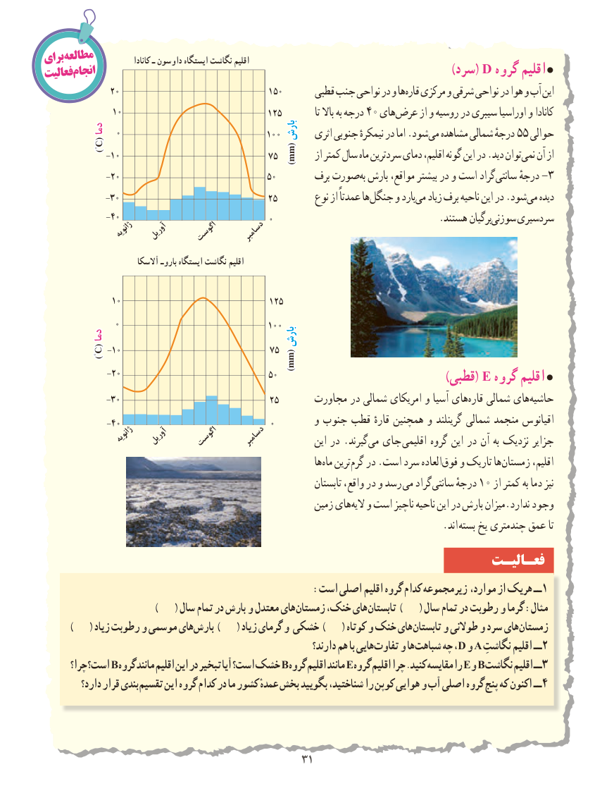

# PDF page 39

برایمطالعه              کانادا ـ داوسون ایستگاه نگاشت اقلیم
                                                             فعالیتانجام                  )Dسرد(   گروه اقلیم
              20                               150      قطبی جنب نواحی در و ها قاره مرکزی و شرقی نواحی در هوا و آب این
              10                              125            تا باال به درجه 40 هایعرض‌      از و روسیه در سیبری اوراسیا و کانادا
       دمادما  0                              100بارشبارش   اثری جنوبی نیمکرهٔ در اما .شود می مشاهده شمالی درجهٔ 55 حوالی
               )°C(
             -10                              75                                                       mm()mm     از کمتر سال ماه سردترین دمای اقلیم، گونه این در .دید توان نمی آن از
             -20                              50       برف صورت به بارش مواقع، بیشتر در و است گراد سانتی درجهٔ -3
             -30                              25        نوع از عمدتاً هاجنگل‌     و باردمی‌   زیاد برف ناحیه این در .شود می دیده
             -40                              0      .‌هستند برگیانسوزنی سردسیری
                ژانویه  آوریل    اگوست    دسامبر
                           آالسکا باروـ ایستگاه نگاشت اقلیم

              10                              125
               0                              100
       دمادما                                  بارشبارش
               )°C( -10                              75
                                                       mm()mm
              -20                              50                                            )قطبی( E گروه اقلیم 
             -30                               25      مجاورت در شمالی امریکای و آسیا های‌قاره شمالی های‌حاشیه
             -40                              0        و جنوب قطب قارهٔ همچنین و گرینلند شمالی منجمد اقیانوس
                 ژانویه  آوریل    اگوست    دسامبر           این در .گیرند‌می جای  اقلیمی گروه این در آن به نزدیک جزایر
                                                                      ها‌ماه ترینگرم‌   در .است سرد العادهفوق‌   و تاریک هازمستان‌        اقلیم،
                                                                      تابستان واقع، در و رسد می گراد ‌سانتی درجهٔ 10 از کمتر به دما نیز
                                                         زمین هایالیه‌   و است ناچیز ناحیه این در بارش میزان.ندارد وجود
                                             . اند بسته یخ چندمتری عمق تا
                                                                   فعـالیـت
                                               :است اصلی اقلیم گروه کدام زیرمجموعه موارد، از هریک ــ 1
                                    )     ( سال تمام در بارش و معتدل های زمستان خنک، های تابستان )     ( سال تمام در رطوبت و گرما :مثال
         )     ( زیاد رطوبت و موسمی های بارش )     ( زیاد گرمای و خشکی )     ( کوتاه و خنک های تابستان و طوالنی و سرد های زمستان
                                                                     دارند؟ هم با هایی تفاوت و ها شباهت چه ،D و A نگاشتِــاقلیم 2
       چرا؟ است؟ Bگروه مانند اقلیم این در تبخیر آیا است؟ خشک Bگروه اقلیم مانند Eگروه اقلیم چرا .کنید مقایسه را Eو Bنگاشت اقلیم ــ3
          دارد؟ قرار بندی تقسیم این گروه کدام در ما کشور عمدهٔ بخش بگویید شناختید، را کوپن هوایی و آب اصلی گروه پنج که اکنون ــ 4

                                             3131

