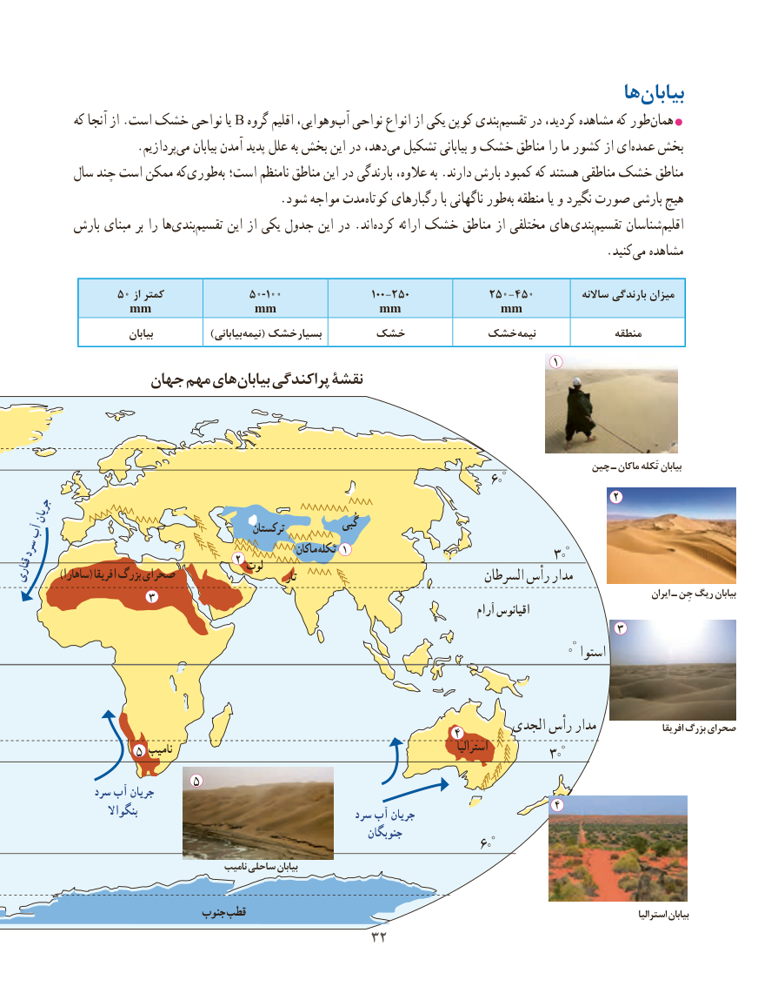

# PDF page 40

ها‌بیابان
            که آنجا از .است خشک نواحی یا B گروه اقلیم وهوایی، ‌آب نواحی انواع از یکی کوپن بندی ‌تقسیم در کردید، مشاهده که طور ‌همان
                     .پردازیم‌می بیابان آمدن پدید علل به بخش این در دهد،می‌  تشکیل بیابانی و خشک مناطق را ما کشور از ایعمده‌   بخش
          سال چند است ممکن که‌طوری ‌به است؛ نامنظم مناطق این در بارندگی عالوه، به .دارند بارش کمبود که هستند مناطقی خشک مناطق
      .‌شود مواجه مدتکوتاه رگبارهای با ناگهانی طوربه‌ منطقه یا و نگیرد صورت بارشی هیچ
          بارش مبنای بر را ها‌بندی‌تقسیم این از یکی جدول این در .اند ‌کرده ارائه خشک مناطق از مختلفی های  بندی‌تقسیم شناساناقلیم‌
                                         .‌کنید می مشاهده

                5 ۰ از کمتر            5۰-1۰۰                100-250            25۰-45۰          ساالنه بارندگی میزان
           mm         mm         mm         mm
                             بیابان   )‌بیابانینیمه( بسیارخشک      خشک        خشک‌نیمه              منطقه
                                                                                   1
                 جهانجهان مهممهم هایهای  بیابانبیابان پراکندگیپراکندگی نقشۀنقشۀ

                                                                                               چین ـ ماکان تَکله بیابان
                                                                                           60°
                                                                                            2
   جریان                                                                                     گُبی آب                                            ترکستان
                                                                                                                                   ° سرد                                                                   ماکان تَکله 1                              ۳۰                                   2قناری       )ساهارا( افریقا بزرگ صحرای             لوت     تار                                 السرطان رأس مدار
                     3                                                                                                                                 ایران ـ جِن ریگ بیابان                                                                                                     آرام اقیانوس
                                                                                             3
                                                                         ۰° استوا

                                                                             الجدی رأس مدار                  افریقا بزرگ صحرای                                                                    64                             نامیب                                                                        استرالیا                    5                                                            ۳۰°
                            5                سرد آب جریان
                                                                                            4                        بنگواال                                                               سرد آب جریان
                                                                         جنوبگان
                                                                                         60°
                                               نامیب ساحلی بیابان

                                 جنوب قطب                                                                                                            استرالیا بیابان
                                            3232

