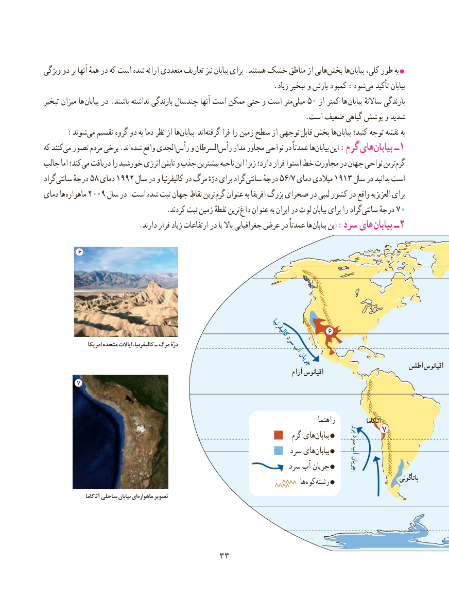

# PDF page 41

ویژگی دو بر آنها همهٔ در که است شده ارائه متعددی تعاریف نیز بیابان برای .هستند خشک مناطق از هایی‌بخش ها‌بیابان کلی، طور به 
                                                                .زیاد تبخیر و بارش کمبود :شودمی‌   تأکید بیابان
تبخیر میزان ها بیابان در .باشند نداشته بارندگی چندسال آنها است ممکن حتی و است مترمیلی‌   50 از کمتر ها بیابان ساالنهٔ بارندگی
                                                                         .است ضعیف گیاهی پوشش و شدید
  :‌شوند می تقسیم گروه دو به دما نظر از هابیابان‌   .اندگرفته‌     فرا را زمین سطح از توجهی‌ قابل بخش هابیابان‌     کنید؛ توجه نقشه به
که کنندمی‌  تصور مردم برخی .اندشده‌   واقع الجدیرأس‌    و السرطانرأس‌    مدار مجاور نواحی در عمدتاً هابیابان‌    این :گرم هایبیابان‌    ـ1
جالب اما کند؛ می دریافت را خورشید انرژی تابش و جذب بیشترین ناحیه این زیرا دارد؛ قرار استوا خط مجاورت در جهان نواحی ترینگرم‌
گراد سانتی درجهٔ 58 دمای 1992 سال در و کالیفرنیا در مرگ درّهٔ برای گراد سانتی درجهٔ 56/7 دمای میالدی 1913 سال در بدانید است
دمای ها ماهواره 2009 سال در .است شده ثبت جهان نقاط ترین گرم عنوان به افریقا بزرگ صحرای در لیبی کشور در واقع العزیزیه برای
   . کردند ثبت زمین نقطهٔ ترین داغ عنوان به ایران در لوت بیابان برای را گراد سانتی درجهٔ 70
                          .دارند قرار زیاد ارتفاعات در یا باال جغرافیایی عرض در عمدتاً ها بیابان این :سرد های ‌بیابان ـ2

          6

                                                                                      کالیفرنیا         6
                   امریکا متحده ایاالت کالیفرنیا، ـ مرگ درّۀ                  سرد                               آب
                                                                جریان                                                                                                      اطلس اقیانوس                                                                                          آرام اقیانوس
         7

                                                                                              راهنما              آتاکاما
                                                                 پرو                                                                        7                                                                            گرم های‌بیابان   سرد
                                           آب                                                                سرد هایبیابان‌  
                                                               سرد آب جریان     جریان
                                                                                          ها‌کوه ‌رشته                           پاتاگونی
                    آتاکاما ساحلی بیابان ای ماهواره تصویر

                                  3333

